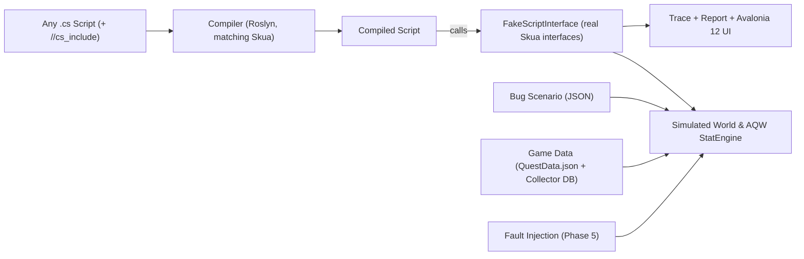

# Plan — Offline Test Environment for Skua Scripts ("SkuaSim")

## Objective
An **offline, reproducible, standalone, and detailed** test environment where **any Skua/VibeSkua script** (Army, Core*, Farm, Story, Daily, Ultra, etc.) can be compiled and executed against a **simulated game state**. When a bug report arrives, developers can reproduce the user's exact scenario independently (with zero AI dependency), inspect every API call step-by-step, and verify the fix.

> [!IMPORTANT]
> This does **not** recreate AQW or use Artix Entertainment's assets or servers. Scripts only interact with the game through the Skua API (`IScriptInterface` and related interfaces), so we only need to simulate **that API** and a lightweight in-memory world behind it.

## Architecture

### Components
| # | Component | Status | Description |
|---|---|---|---|
| 1 | **Collector (`SkuaSim.Collector`)** | ✅ Done (v1) · 🔜 v2 Expansion | Passive plugin for VibeSkua/Skua that captures maps, cells, monsters, combat damage (`ct.sara[].actionResult`), HoT/DoT (`typ: "d"`), auras & stack counts (`stk`), skill animations (`animStr`), zone events, drop counts, map items, shops, quests, classes/skills/stats (`sAct`/`stu`), enhancements, Awe/Forge proc rates, and cross-session anonymized `packet_schemas.json` into `gamedata.json` (multi-client safe via global `Mutex`). **Upcoming v2:** `Maps[mapName].MaxPlayers` (`world.areaData.intMaxPlayers`), `QuestGated` `EligibleKills` precision, and cached/throttled `getMonsterDrops` official drop metadata. |
| 2 | **Loader / Compiler** | ✅ Done | Recursively resolves `//cs_include` directives and compiles scripts with Roslyn against the **real Skua assemblies** (`Skua.Core.*`) in collectible per-run `AssemblyLoadContext`s, rewriting time APIs to the virtual clock (`TimeHookRewriter`). |
| 3 | **FakeScriptInterface** | ✅ Core Done | Implements the Skua interfaces (`Player`, `Map`, `Monsters`, `Combat`, `Kill`, `Hunt`, `Inventory`, `TempInv`, `Bank`, `House`, `Quests`, `Drops`, `Shops`, `Skills`, `Boosts`, `Options`, `Config`, `Wait`, `Send`, `Events`, `Flash`, `Stats`, `Lite`, `Accounts`, `Handlers`, `Servers`, etc.) via `ProxyHub`. |
| 4 | **Simulated World & AQW StatEngine** | ✅ Core Done | 3-tier in-memory game state (Scenario → Collector DB + `QuestData.json` → AST-assisted synthesized fallbacks flagged in reports), authentic AQW `StatEngine` (STR/INT/END/DEX/WIS/LCK, Crit, 50% Haste cap, Dodge, class-skill calibration), real AQW boosted gear catalog (`AqwBoostGearCatalog`), Awe/Forge quest unlocks (`EnhancementUnlockCatalog`), and `2x` consumable/server boosts. |
| 5 | **Virtual Clock** | ✅ Done | `bot.Sleep`, `Wait.For*`, `Thread.Sleep`, `Task.Delay`, `DateTime`, and `Stopwatch` advance simulated time deterministically (`same seed = identical outcome`). Supports minutes, hours, days, weeks, and Unlimited (`0`) virtual & real execution limits with multi-day clock formatting (`Xd hh:mm:ss.fff`). |
| 6 | **CLI (`skuasim.exe`)** | ✅ MVP Done | Standalone offline executable: `skuasim db-stats`, `skuasim compile <script.cs>`, `skuasim run <script.cs> --scenario <file.json> --seed 42`. |
| 7 | **Visual UI (`SkuaSim.UI`)** | ✅ Done | Standalone Avalonia 12 desktop dashboard ("Skua without Flash") with adaptive multi-resolution scaling (`Auto`, HD–8K), standardized typography, responsive splitters, live client/AQW combat state, databank class & live stats preview, real AQW boosted equipment picker, Awe/Forge enhancement checklists (with master + per-category `All Weapon`/`All Helm`/`All Cape`), Skua-faithful `Script Options` (`CheckBox` booleans, `MultiOptions` tabs, headers, `Reset Defaults`, `Load Skua .cfg`), color-coded Logs/Errors/Trace (Violet for Synthesized data), and `.md`/`.json` export. |
| 8 | **Multi-Client (Army)** | 🔜 Next (Phase 4) | Up to **20 concurrent simulated players** (`1–20` accounts) sharing rooms, monster HP pools, party buffs/auras, `Goto`/cell tracking, and Army sync files (`*.sync`, `character_locations`, `army-control-jump.json`) on synchronized virtual-clock threads. |
| 9 | **CoreBots CBO, Skua Runtime Options, Live Swaps & Potions** | 🔜 Next (Phase 4) | Scenario-driven `CoreBots.cs` (`CBO_Storage`) + functional `Bot.Options`/`Bot.Lite` overrides (`Solo`/`Farm`/`Dodge`/`Boss` classes & gear, `DisableBestGear`, `DisableAutoEnhance`, `RestCheck`, `PrivateRooms`/`PublicDifficult`, `BankMiscAC`, `ActionDelay`/`HuntDelay`, `AcceptACDrops`, `AggroMonsters`, `SafeTimings`, `HuntPriority`, `ReacceptQuest`), real-time live class & enhancement swaps (`Core.EquipClass`, `Adv.EnhanceItem`), and full Potion/Elixir/Tonic/Scroll simulation (for `UltrasLW` and endgame scripts). |
| 10 | **Fault Injection & Asserts** | 🔜 Planned (Phase 5) | Disconnects, lag spikes, full rooms, failed `Join`, quest failure, dry drop streaks, infinite-loop/regression detection, declarative scenario `asserts`, diagnostic file generator, and bug report templates. |
| 11 | **Replay & Public Release** | 🔜 Planned (Phase 6) | Real session log replay, official Skua parity pass, CLI `--skua-*` flags + `init-scenario`/`merge-data`, baseline starter DB, open-source license, and packaged releases. |

## Game Data Sources (Fidelity)
- **`QuestData.json`** (already available in VibeSkua/Skua): quest definitions, requirements, and rewards.
- **Passive Collector Plugin (`SkuaSim.Collector`)**: runs passively inside VibeSkua/Skua during normal use and saves anonymized maps, cells, monsters, combat telemetry, class skills, observed drop rates, map items, shops, and quests into `gamedata.json` (plus anonymized structural packet samples in `packet_schemas.json`).
- **Automatic Fallbacks**: when data is missing, the simulated world generates plausible defaults (synthesized monsters, AST-inferred targets/shop items, 50% default drop rate, etc.) and explicitly flags every synthesized entity in **Violet** in the UI diagnostics and execution reports.

> [!WARNING]
> **Honest Limitations:**
> - **Windows-only:** scripts such as `CoreBots.cs` reference `System.Windows.Forms`, requiring Windows and `Microsoft.WindowsDesktop.App`.
> - **Data fidelity:** simulation excels at catching **script logic bugs** (control flow, conditions, loops, inventory/bank/quest accounting, purchase math — already validated by catching a real infinite-loop bug in `CoreFarms.SwagTokenA`!). Bugs that depend on **exact server timing, Ultra boss aura/zone choreography, or Flash client quirks** require either Phase 4 (Army/Aura combat simulation) or Phase 6 (real session log replay).

## Phases
| Phase | Deliverable | Status | Outcome |
|---|---|---|---|
| **1 — MVP** | Loader + compiler + core `FakeScriptInterface` + virtual clock + trace | ✅ Done | Scripts compile unchanged (tested up to 171 `//cs_include` files) and run deterministically with detailed reports |
| **2 — Data-Driven World** | Import `QuestData.json` + Collector `gamedata.json` + JSON scenario format + AQW `StatEngine` | ✅ Done | Reproduce specific user states (level, class, real AQW boosted gear, Awe/Forge unlocks, boosts, quests) |
| **3 — Visual Interface (`SkuaSim.UI`)** | Avalonia 12 desktop dashboard ("Skua without Flash") + UX & Collector protocol polish | ✅ Done | Multi-resolution UI (HD–8K), live client/stats state, real AQW gear & enhancement editor, Skua-faithful `Script Options` + `.cfg` import, unlimited virtual & real execution limits, color-coded Logs/Diagnostics/Trace, and `.md`/`.json` export |
| **3.5 — Collector Schema v2 & Official Drops (`SkuaSim.Collector`)** | `gamedata.json` v1 → v2 migration, `MaxPlayers` (`world.areaData.intMaxPlayers`), `QuestGated` `EligibleKills` accuracy, and cached/throttled `getMonsterDrops` | 🔜 Next (Quick Wins) | Eliminates `EligibleKills` distortion on quest-gated drops, provides official monster drop lists, and supplies real per-map `MaxPlayers` for Multi-Client Army routing |
| **4 — Multi-Client (Army), Live Loadouts, Potions & Boss/Aura Combat** | Up to 20 concurrent clients, `Solo`/`Farm`/`Dodge`/`Boss` role classes + live class/enhancement swaps, Potions/Elixirs/Tonics/Scrolls (`UltrasLW`), and active aura/zone/Ultra boss combat | 🔜 Next | Test Army scripts (`ArmyFarmerJoeDoAll.cs`), `UltrasLW` potion/taunt teams, and dynamic CBO class/enhancement switching end-to-end |
| **5 — Faults, Asserts & Bug Templates** | Fault injection (lag/disconnect/drop droughts), scenario `asserts`, diagnostic generator & bug report template | 🔜 Planned | End-to-end workflow: "bug → scenario → reproduce → fix → automated regression test passes" |
| **6 — Replay, OMNISCOPE Unification & Public Packaging** | Real session log replay, official Skua parity, OMNISCOPE SWF/Cross-Ref integration (`wtffidy/VibeSkua`), CLI flags (`merge-data`, `init-scenario`), and release bundle | 🔜 Planned | Reproduce server-dependent edge cases, unify offline map/drop/combat intelligence with OMNISCOPE, and distribute cleanly to external developers |

## Collector Schema v2 & OMNISCOPE Unification Plan
1. **Collector Phase 1 — Schema v2 Migration & Statistical Accuracy (`SkuaSim.Collector`):**
   - **Safe Migration (`SchemaVersion: 1 -> 2`):** preserve 100% of existing captured data in `gamedata.json` (flushes, monsters, drops, combat, classes, shops, quests) with zero data loss.
   - **Room Player Limits (`Maps[mapName].MaxPlayers`):** upon `MapChanged` / `moveToArea`, read the server-side authoritative room cap from `world.areaData.intMaxPlayers` (distinct from `Server.MaxPlayers` / `iMax`) and store `MaxPlayers`, `MaxPlayersSource` (`"runtime:world.areaData.intMaxPlayers"`), and `MaxPlayersObservedUtc`. Enables instant pre-join room limit lookups after the first visit and accurate room-capacity enforcement in Phase 4 Army simulation.
   - **Quest-Gated Drop Precision (`EligibleKills`):** extend `Monsters[key].Drops[itemId]` with `IsOfficialDrop`, `QuestGated`, `RequiredQuestIds`, `QuestObjective`, `ObservedDrops`, `EligibleKills`, and `RateBasis` (`"all_kills"` vs `"quest_active_kills"`). For quest-gated drops (via `monsterDrops` or cross-referenced with `Quests[*].Requirements`), increment `EligibleKills` only when the corresponding quest is active in `Bot.Quests.Active`.
2. **Collector Phase 2 — Official Drops Collection (`getMonsterDrops`) with Cache & Throttling:**
   - Implement an async, cancellable `MonsterDropMetadataCollector` service that queries `getMonsterDrops` for `MonMapID`s on map entry or manual rescan.
   - **Persistent Cache & Throttling:** skip `(Map, MonMapID)` pairs that already have `OfficialDropsFetchedUtc` (unless manual *Rescan*), enforce a mandatory `600–800 ms` delay between requests, and apply per-session/per-map caps.
   - **Non-Destructive Merge:** merge `IsOfficialDrop = true`, `QuestGated`, and `QuestObjective` into `gamedata.json` while keeping passively observed `DropEvents` and `EligibleKills` intact (items confirmed by the server that never dropped yet show `DropEvents = 0` and `EstimatedDropChance = null`).
3. **Downstream OMNISCOPE Unification (`wtffidy/VibeSkua` — Phases 3–5):**
   - **Static Map SWF Extractor (`MapSwfExtractor`):** expand `Skua.Plugin.Omniscope` (`AqwMapSwfDownloader.cs`, `SwfSourceIndexer.cs`, `LocationSwfShopIndexer.cs`) to extract map cells/labels, quest/mapItem references (`getMapItem`, `isQuestInProgress`), shop/merge references, and static NPC/monster names into `map_swf_index.json` (SHA-256 cached, comment-stripped ActionScript parser). *Note: Monster SWFs are excluded because they only contain art/animations; monster damage, intervals, and auras come from `SkuaSim.Collector`'s `ct` packets.*
   - **Cross-Reference Engine & Explorer UI:** unify `map_swf_index.json` + `gamedata.json` into a relational graph (`Map ↔ Monster ↔ Quest ↔ Shop/Merge`) with explicit provenance (`static:swf`, `server:packet`, `runtime:observed`, never fabricating missing fields) and expose it in `OmniscopeWindow` and generators (`WeeklyReleaseGeneratorV3` / `MergeTemplateHelperV3`).

## Phase 4 — Next Milestone Scope (Multi-Client Army, Live Loadouts, Potions & Aura/Boss Simulation)
1. **Shared World Room & Multi-Client Coordinator (`ArmySimulationRunner` — up to 20 players):**
   - Spawn `1` to `20` simulated clients concurrently in one shared `SimWorld` room system with a single synchronized `SimClock` (lockstep/event-driven virtual time across client threads so no account races ahead in virtual time).
   - Shared room monster instances (HP pool, aggro/taunt, simultaneous DPS contributions, shared kill credit, and per-player drop rolls).
   - Multi-account `Bot.Map.PlayerNames` / `Bot.Map.Players`, `Bot.Player.Goto(playerName)`, party invites/membership, and isolated per-account `Inventory`/`Bank`/`Quests`/`Options` while sharing `Army*.sync` / `character_locations/` / `army-control-jump.json` coordination cleanly.
2. **CoreBots (`CBO_Storage`), Functional Skua Options & Live Class/Enhancement Swapping:**
   - **Scenario CBO (`CoreBotsOptions`) Integration:** materialize an isolated per-run `CBO_Storage(<Username>).txt` from the scenario (with 1-click **Load CBO...** import from existing VibeSkua/Skua `options/` files in `SkuaSim.UI`) so `CoreBots.SetOptions()` / `ReadCBO()` deterministically receives scenario settings without leaking real disk profiles:
     - **Combat Role Classes & Gear:** `SoloClass`, `FarmClass`, `DodgeClass`, `BossClass` (+ `ClassUseMode`, per-role `EquipCheck`/gear lists), pre-seeded into inventory/bank and backed by the Collector databank.
     - **CoreBots Decision Flags:** `DisableBestGear`, `DisableAutoEnhance`, `RestCheck`, `PrivateRooms` + `PrivateRoomNr`, `PublicDifficult`, `BankMiscAC`, `BankUnenhancedACGear`, `MessageBoxCheck`, `StopLocationSelect`, `ActionDelay`, `ExitCombatNr`, `HuntDelayNr`, `QuestTriesNr`, `QuestMaxNr` (plus syncing CBO boost flags with scenario Boosts).
   - **Functional `Bot.Options` & `Bot.Lite` Overrides (UI + Scenario):** expose only simulation-impacting Skua runtime options (`AcceptACDrops`, `AcceptAllDrops`, `RejectAllDrops`, `AggroMonsters`, `AggroAllMonsters`, `HuntPriority`, `RestPackets`, `SafeTimings`, `JoinMapTries`, `QuestAcceptAndCompleteTries`, `Bot.Lite.ReacceptQuest`), explicitly excluding cosmetic/FPS/UI-only flags (`HidePlayers`, `DisableFX`, `LagKiller`, `IncognitoMode`, `SetFPS`, `CustomName`, etc.).
   - **Live Class & Enhancement Swaps:** fully simulate mid-run class switches (`Core.EquipClass(ClassType.Solo/Farm/Dodge/Boss)`, `Bot.Inventory.Equip`) and live enhancement changes (`Adv.EnhanceItem`, `%xt%zm%enhanceItemShop%`, Awe/Forge swaps), immediately recalculating `StatEngine` (HP, DPS, Crit, Haste, Dodge, skills, and procs) and updating Live Client telemetry.
3. **Potions, Elixirs, Tonics & Scrolls Simulation (`UltrasLW` Support):**
   - Model real AQW consumables (Potions, Elixirs, Tonics, and Scrolls — e.g., *Fate Tonic*, *Sage Tonic*, *Body Tonic*, *Potent Battle/Malevolence/Destruction/Revitalize Elixir*, *Potent Honor/Malice Potion*, *Felicitous Philtre*, *Scroll of Enrage*, etc.) with inventory stack consumption, equip-to-potion-slot (`skill 5`), cooldowns, virtual-clock buff durations, stat/DPS/heal/taunt effects in `StatEngine`, and aura visibility.
4. **Active Aura, Buff & Ultra Boss Mechanics Engine (using Collector's captured `ct`/aura/zone data):**
   - Simulate timed player & monster auras (`Bot.Self.HasActiveAura`, `Bot.Target.HasActiveAura`, stacks `stk`, party buffs like LoO/AP/SC/LR) and boss cues (`animStr`, event zones, nuke intervals) captured in `gamedata.json`.
5. **Army Scenario & UI Support:**
   - Multi-account scenario definitions (`accounts[]`, supporting up to 20 players with per-account username, level, role classes, boosts, enhancements, potions, and script options) and an **Army Overview** tab in `SkuaSim.UI` showing all accounts' live map/cell/HP/class/status, per-account logs, and synchronized pause/stop.

## Public Distribution & Developer Release Checklist
`SkuaSim` is **100% standalone** (zero AI dependency, runs completely offline on any developer's machine). Before publishing a public release for external developers:

### End-User Requirements
1. **OS:** Windows (required by `System.Windows.Forms` references in `CoreBots.cs` and Skua scripts).
2. **.NET Runtime:** .NET 10 Desktop Runtime (`Microsoft.WindowsDesktop.App`), or publish `SkuaSim` as a self-contained binary.
3. **Installed Client:** **VibeSkua** or **official Skua** installed locally (plus `Scripts\` and `QuestData.json`). `SkuaSim` uses `<Private>false</Private>` and resolves `Skua.Core.*` assemblies from the user's machine at runtime without redistributing third-party client binaries.

### Pre-Release Tasks
1. **CLI & Config Ergonomics:** expose `--skua-assemblies`, `--skua-data`, and `--scripts-dir` flags in `SkuaSim.Cli` (complementing `SKUASIM_SKUA_ASSEMBLIES` / `SKUASIM_SKUA_DATA` env vars), update `--max-real-sec` help text default to `0`, and add `skuasim init-scenario` and `skuasim merge-data` commands for merging Collector exports.
2. **Official Skua Compatibility Pass:** verify assembly resolution, .NET version compatibility, and interface signatures against an official Skua installation (currently verified on VibeSkua / .NET 10).
3. **Baseline Game Database:** curate a clean, anonymized starter `data/gamedata.json` in the release so developers can test common maps/monsters immediately without waiting to collect data first.
4. **Repository Hygiene & Packaging:** ✅ `.gitignore` and ✅ English `README.md` done; remaining: open-source license (`LICENSE`) and automated packaged release archive (`skuasim.exe`, `SkuaSim.UI`, `SkuaSim.Collector.dll`).
5. **Security & Privacy Notice:** document clearly (already covered in `README.md`) that `SkuaSim.Collector` never records personal/account data, and that `SkuaSim` compiles and executes real C# script code locally.

## Project Structure
Everything resides directly in this workspace (`SkuaSim\`), organized into .NET 10 projects (`SkuaSim.Collector`, `SkuaSim.Core`, `SkuaSim.Cli`, `SkuaSim.UI`, `SkuaSim.Collector.Tests`, `SkuaSim.Core.Tests`). Existing scripts are **never** modified, and the ArmyFarmerJoeDoAll repository remains completely separate.

## Confirmed Decisions
1. **Target:** compatible with both **VibeSkua and official Skua** (resolving `Skua.Core.*` assemblies dynamically at runtime).
2. **Language:** all source code, UI, CLI, logs, tests, and documentation in **English**.
3. **Execution Order:**
   - **Stage 1 — Collector (`SkuaSim.Collector`):** ✅ Done & verified on live AQW data (6/6 tests).
   - **Stage 2 — Simulator MVP & Data World (`SkuaSim.Core` + `SkuaSim.Cli`):** ✅ Done & verified (11/11 tests).
   - **Stage 3 — Visual Interface (`SkuaSim.UI`) & Realistic AQW Setup Polish:** ✅ Done & verified.
   - **Stage 4 — Multi-Client (Army) & Aura/Boss Combat Engine:** 🔜 Next priority.
   - **Stage 5 — Fault Injection, Scenario Assertions & Bug Report Templates:** 🔜 Planned.
   - **Stage 6 — Session Replay & Public Release Packaging:** 🔜 Planned.
