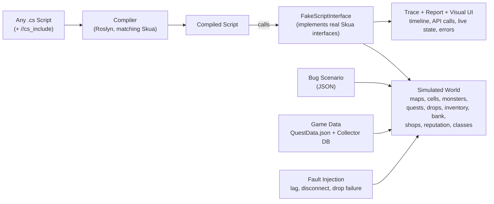

# Plan — Offline Test Environment for Skua Scripts ("SkuaSim")

## Objective
An **offline, reproducible, standalone, and detailed** test environment where **any Skua/VibeSkua script** (Army, Core*, Farm, Story, Daily, Ultra, etc.) can be compiled and executed against a **simulated game state**. When a bug report arrives, developers can reproduce the user's exact scenario independently (with zero AI dependency), inspect every API call step-by-step, and verify the fix.

> [!IMPORTANT]
> This does **not** recreate AQW or use Artix Entertainment's assets or servers. Scripts only interact with the game through the Skua API (`IScriptInterface` and related interfaces), so we only need to simulate **that API** and a lightweight in-memory world behind it.

## Architecture

### Components
| # | Component | Status | Description |
|---|---|---|---|
| 1 | **Collector (`SkuaSim.Collector`)** | ✅ Done | Passive plugin for VibeSkua/Skua that records maps, cells, monsters, combat damage/auras, drop counts, map items, shops, and quests into `gamedata.json` (multi-client safe via global `Mutex`). |
| 2 | **Loader / Compiler** | ✅ Done | Recursively resolves `//cs_include` directives and compiles scripts with Roslyn against the **real Skua assemblies** (`Skua.Core.*`) in isolated `AssemblyLoadContext`s, rewriting time APIs to the virtual clock. |
| 3 | **FakeScriptInterface** | ✅ Core Done | Implements the Skua interfaces (`Player`, `Map`, `Monsters`, `Combat`, `Kill`, `Hunt`, `Inventory`, `TempInv`, `Bank`, `House`, `Quests`, `Drops`, `Shops`, `Skills`, `Options`, `Wait`, `Send`, `Events`, `Flash`, `Stats`, `Lite`, `Accounts`, `Handlers`, `Servers`, etc.). |
| 4 | **Simulated World** | ✅ Core Done | 3-tier in-memory game state (Scenario → Collector DB + `QuestData.json` → AST-assisted synthesized fallbacks flagged in reports). |
| 5 | **Virtual Clock** | ✅ Done | `bot.Sleep`, `Wait.For*`, `Thread.Sleep`, `Task.Delay`, `DateTime`, and `Stopwatch` advance simulated time deterministically (`same seed = identical outcome`). |
| 6 | **CLI (`skuasim.exe`)** | ✅ MVP Done | Standalone offline executable: `skuasim db-stats`, `skuasim compile <script.cs>`, `skuasim run <script.cs> --scenario <file.json> --seed 42`. |
| 7 | **Visual UI (`SkuaSim.UI`)** | 🔜 Planned | Standalone desktop interface ("Skua without Flash") showing live simulated world state, script logs, scenario editor, and an error/trace inspector. |
| 8 | **Multi-Client (Army)** | 🔜 Planned | N simulated players sharing the same world/rooms and sync files, each executing on its own thread to test Army scripts and synchronization. |
| 9 | **Fault Injection & Asserts** | 🔜 Planned | Disconnects, lag, full room, failed `Join`, quest failure, dry drop streaks, stall/loop detection, and scenario assertions (`inventoryContains`, `questsCompleted`, etc.). |

## Game Data Sources (Fidelity)
- **`QuestData.json`** (already available in VibeSkua/Skua): quest definitions, requirements, and rewards.
- **Passive Collector Plugin (`SkuaSim.Collector`)**: runs passively inside VibeSkua/Skua during normal use and saves anonymized maps, cells, monsters, combat stats, observed drop rates, map items, shops, and quests into `gamedata.json`.
- **Automatic Fallbacks**: when data is missing, the simulated world generates plausible defaults (synthesized monsters, AST-inferred targets/shop items, 50% default drop rate, etc.) and explicitly flags in the report that **those values were synthesized**.

> [!WARNING]
> **Honest Limitations:**
> - **Windows-only:** scripts such as `CoreBots.cs` reference `System.Windows.Forms`, requiring Windows and `Microsoft.WindowsDesktop.App`.
> - **Data fidelity:** simulation excels at catching **script logic bugs** (control flow, conditions, loops, inventory/bank/quest accounting, purchase math — already validated by catching a real infinite-loop bug in `CoreFarms.SwagTokenA`!). Bugs that depend on **exact server timing or Flash client quirks** (live packet jitter, deep ActionScript `Bot.Flash` calls, undocumented boss mechanics) may not reproduce until captured or replayed in Phase 5.

## Phases
| Phase | Deliverable | Status | Outcome |
|---|---|---|---|
| **1 — MVP** | Loader + compiler + core `FakeScriptInterface` + virtual clock + trace | ✅ Done | Scripts compile unchanged (tested up to 171 `//cs_include` files) and run deterministically with detailed reports |
| **2 — Data-Driven World** | Import `QuestData.json` + Collector `gamedata.json` + JSON scenario format | ✅ Done | Reproduce specific user states (inventory, bank, quests, class, stats) |
| **3 — Visual Interface (`SkuaSim.UI`)** | Avalonia desktop dashboard ("Skua without Flash") | 🔜 Planned | Run/pause/stop scripts visually, inspect live map/monsters/inventory/quests, view real-time Logs and Error/Trace inspector |
| **4 — Multi-Client (Army)** | N clients, shared rooms, party & sync files (`character_locations`, `Goto`) | 🔜 Planned | Test Army scripts (`ArmyFarmerJoeDoAll.cs`) and multi-account synchronization |
| **5 — Faults, Asserts & Templates** | Fault injection, stall detector, scenario `asserts`, diagnostic generator & bug report template | 🔜 Planned | End-to-end workflow: "bug → scenario → reproduce → fix → automated regression test passes" |
| **6 — Replay & Packaging** | Real session log replay + public developer release tooling | 🔜 Planned | Reproduce server-dependent edge cases and distribute cleanly to external developers |

## Visual Interface Design (`SkuaSim.UI`)
A standalone desktop GUI (Avalonia, matching VibeSkua's stack) wired directly to `SimulationRunner`:
- **Execution Controls:** script `.cs` browser, scenario `.json` loader + visual form editor (level, class, member, inventory, bank, quests, script options), seed input, virtual speed/time limits, and **Run / Pause / Stop** buttons.
- **Live Client State ("Skua without Flash"):** current map & cell, monsters in room/cell with live HP bars, player HP/gold/class, inventory/bank/temp inventory tabs, and active/completed quests.
- **Logs Tab:** live scrolling script logs matching Skua's Logs tab.
- **Errors & Diagnostics Screen:** highlighted exception stack trace (file + line number), loop/stall warnings, synthesized data warnings, and searchable API call timeline (`trace`).

## Public Distribution & Developer Release Checklist
`SkuaSim` is **100% standalone** (zero AI dependency, runs completely offline on any developer's machine). Before publishing a public release for external developers:

### End-User Requirements
1. **OS:** Windows (required by `System.Windows.Forms` references in `CoreBots.cs` and Skua scripts).
2. **.NET Runtime:** .NET 10 Desktop Runtime (`Microsoft.WindowsDesktop.App`), or publish `SkuaSim` as a self-contained binary.
3. **Installed Client:** **VibeSkua** or **official Skua** installed locally (plus `Scripts\` and `QuestData.json`). `SkuaSim` uses `<Private>false</Private>` and resolves `Skua.Core.*` assemblies from the user's machine at runtime without redistributing third-party client binaries.

### Pre-Release Tasks
1. **CLI & Config Ergonomics:** expose `--skua-assemblies`, `--skua-data`, and `--scripts-dir` flags in `SkuaSim.Cli` (complementing `SKUASIM_SKUA_ASSEMBLIES` / `SKUASIM_SKUA_DATA` env vars), plus `skuasim init-scenario` and `skuasim merge-data` commands for merging Collector `.zip` exports (Option B).
2. **Official Skua Compatibility Pass:** verify assembly resolution, .NET version compatibility, and interface signatures against an official Skua installation (currently verified on VibeSkua / .NET 10).
3. **Baseline Game Database:** include a clean, anonymized starter `data/gamedata.json` in the release so developers can test common maps/monsters immediately without waiting to collect data first.
4. **Repository Hygiene & Packaging:** add `.gitignore` (excluding `bin/`, `obj/`, temporary reports/traces), an open-source license, a comprehensive English `README.md`, and a packaged release archive (`skuasim.exe`, `SkuaSim.UI`, `SkuaSim.Collector.dll`).
5. **Security & Privacy Notice:** document clearly that `SkuaSim.Collector` never records personal/account data, and that `SkuaSim` compiles and executes real C# script code locally (developers should only run trusted scripts).

## Project Structure
Everything resides directly in this workspace (`SkuaSim\`), organized into .NET 10 projects (`SkuaSim.Collector`, `SkuaSim.Core`, `SkuaSim.Cli`, `SkuaSim.UI` [planned], `SkuaSim.Collector.Tests`, `SkuaSim.Core.Tests`). Existing scripts are **never** modified, and the ArmyFarmerJoeDoAll repository remains completely separate.

## Confirmed Decisions
1. **Target:** compatible with both **VibeSkua and official Skua** (using the `Skua.Core.*` assemblies in `C:\Users\lucas\AppData\Local\VibeSkua\current\Assemblies\`).
2. **Language:** all source code, UI, CLI, logs, tests, and documentation in **English**.
3. **Execution Order:**
   - **Stage 1 — Collector (`SkuaSim.Collector`):** ✅ Done — passive plugin for VibeSkua/Skua collecting real game data into `gamedata.json`.
   - **Stage 2 — Simulator MVP & Data World (`SkuaSim.Core` + `SkuaSim.Cli`):** ✅ Done — loader, compiler, `FakeScriptInterface`, virtual clock, 3-tier world, trace, and CLI.
   - **Stage 3+ (Next Priorities):** Visual Interface (`SkuaSim.UI`), Multi-Client (Army), Fault Injection & Assertions, Diagnostic Generator / Bug Report Template, and Public Release Packaging.
