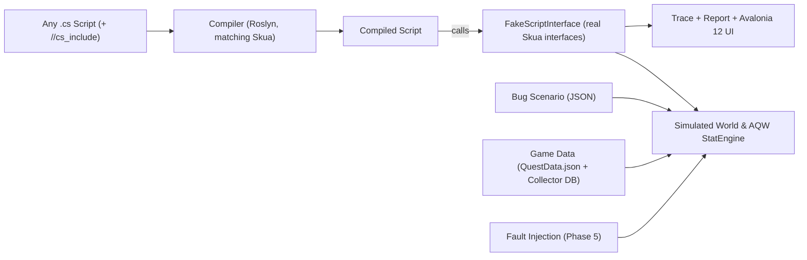

# Plan — Offline Test Environment for Skua Scripts ("SkuaSim")

## Objective
An **offline, reproducible, standalone, and detailed** test environment where **any Skua/VibeSkua script** (Army, Core*, Farm, Story, Daily, Ultra, etc.) can be compiled and executed against a **simulated game state**. When a bug report arrives, developers can reproduce the user's exact scenario independently (with zero AI dependency), inspect every API call step-by-step, and verify the fix.

> [!IMPORTANT]
> This does **not** recreate AQW or use Artix Entertainment's assets or servers. Scripts only interact with the game through the Skua API (`IScriptInterface` and related interfaces), so we only need to simulate **that API** and a lightweight in-memory world behind it.

## Architecture

### Components
| # | Component | Status | Description |
|---|---|---|---|
| 1 | **Collector (`SkuaSim.Collector`)** | ✅ Done (v1) · 🔄 Phase 3.5 corrections | Passive plugin for VibeSkua/Skua that captures maps, cells, monsters, combat damage (`ct.sara[].actionResult`), HoT/DoT (`typ: "d"`), auras & stack counts (`stk`), skill animations (`animStr`), zone events, drop counts, map items, shops, quests, classes/skills/stats (`sAct`/`stu`), enhancements, Awe/Forge proc rates, and cross-session anonymized `packet_schemas.json` into `gamedata.json` (multi-client safe via global `Mutex`). **Phase 3.5 (revised 2026-11-20):** protocol verification, data-quality bug fixes (monster level never captured, quest rewards misattributed as monster drops), schema v2 with passive official drops, real XP/gold per kill and respawn times — see *Collector Correction & Schema v2 Plan*. |
| 2 | **Loader / Compiler** | ✅ Done | Recursively resolves `//cs_include` directives and compiles scripts with Roslyn against the **real Skua assemblies** (`Skua.Core.*`) in collectible per-run `AssemblyLoadContext`s, rewriting time APIs to the virtual clock (`TimeHookRewriter`). |
| 3 | **FakeScriptInterface** | ✅ Core Done | Implements the Skua interfaces (`Player`, `Map`, `Monsters`, `Combat`, `Kill`, `Hunt`, `Inventory`, `TempInv`, `Bank`, `House`, `Quests`, `Drops`, `Shops`, `Skills`, `Boosts`, `Options`, `Config`, `Wait`, `Send`, `Events`, `Flash`, `Stats`, `Lite`, `Accounts`, `Handlers`, `Servers`, etc.) via `ProxyHub`. |
| 4 | **Simulated World & AQW StatEngine** | ✅ Core Done | 3-tier in-memory game state (Scenario → Collector DB + `QuestData.json` → AST-assisted synthesized fallbacks flagged in reports), authentic AQW `StatEngine` (STR/INT/END/DEX/WIS/LCK, Crit, 50% Haste cap, Dodge, class-skill calibration), real AQW boosted gear catalog (`AqwBoostGearCatalog`), Awe/Forge quest unlocks (`EnhancementUnlockCatalog`), and `2x` consumable/server boosts. |
| 5 | **Virtual Clock** | ✅ Done | `bot.Sleep`, `Wait.For*`, `Thread.Sleep`, `Task.Delay`, `DateTime`, and `Stopwatch` advance simulated time deterministically (`same seed = identical outcome`). Supports minutes, hours, days, weeks, and Unlimited (`0`) virtual & real execution limits with multi-day clock formatting (`Xd hh:mm:ss.fff`). |
| 6 | **CLI (`skuasim.exe`)** | ✅ MVP Done | Standalone offline executable: `skuasim db-stats`, `skuasim compile <script.cs>`, `skuasim run <script.cs> --scenario <file.json> --seed 42`. |
| 7 | **Visual UI (`SkuaSim.UI`)** | ✅ Done | Standalone Avalonia 12 desktop dashboard ("Skua without Flash") with adaptive multi-resolution scaling (`Auto`, HD–8K), standardized typography, responsive splitters, live client/AQW combat state, databank class & live stats preview, real AQW boosted equipment picker, Awe/Forge enhancement checklists (with master + per-category `All Weapon`/`All Helm`/`All Cape`), Skua-faithful `Script Options` (`CheckBox` booleans, `MultiOptions` tabs, headers, `Reset Defaults`, `Load Skua .cfg`), color-coded Logs/Errors/Trace (Violet for Synthesized data), and `.md`/`.json` export. |
| 8 | **Multi-Client (Army)** | 🔜 Next (Phase 4) | Up to **20 concurrent simulated players** (`1–20` accounts) sharing rooms, monster HP pools, party buffs/auras, `Goto`/cell tracking, and Army sync files (`*.sync`, `character_locations`, `army-control-jump.json`) on synchronized virtual-clock threads. |
| 9 | **CoreBots CBO, Skua Runtime Options, Live Swaps & Potions** | 🔜 Next (Phase 4) | Scenario-driven `CoreBots.cs` (`CBO_Storage`) + functional `Bot.Options`/`Bot.Lite` overrides (`Solo`/`Farm`/`Dodge`/`Boss` classes & gear, `DisableBestGear`, `DisableAutoEnhance`, `RestCheck`, `PrivateRooms`/`PublicDifficult`, `BankMiscAC`, `ActionDelay`/`HuntDelay`, `AcceptACDrops`, `AggroMonsters`, `SafeTimings`, `HuntPriority`, `ReacceptQuest`), real-time live class & enhancement swaps (`Core.EquipClass`, `Adv.EnhanceItem`), and full Potion/Elixir/Tonic/Scroll simulation (for `UltrasLW` and endgame scripts). |
| 10 | **Fault Injection & Asserts** | 🔜 Planned (Phase 5) · ✅ No-progress detector done early | Disconnects, lag spikes, full rooms, failed `Join`, quest failure, dry drop streaks, infinite-loop/regression detection, declarative scenario `asserts`, diagnostic file generator, and bug report templates. |
| 11 | **Replay & Public Release** | 🔜 Planned (Phase 6) | Real session log replay, official Skua parity pass, CLI `--skua-*` flags + `init-scenario`/`merge-data`, baseline starter DB, open-source license, and packaged releases. |

## Game Data Sources (Fidelity)
- **`QuestData.json`** (already available in VibeSkua/Skua): quest definitions, requirements, and rewards.
- **Passive Collector Plugin (`SkuaSim.Collector`)**: runs passively inside VibeSkua/Skua during normal use and saves anonymized maps, cells, monsters, combat telemetry, class skills, observed drop rates, map items, shops, and quests into `gamedata.json` (plus anonymized structural packet samples in `packet_schemas.json`).
- **Automatic Fallbacks**: when data is missing, the simulated world generates plausible defaults (synthesized monsters, AST-inferred targets/shop items, 50% default drop rate, etc.) and explicitly flags every synthesized entity in **Violet** in the UI diagnostics and execution reports.

> [!WARNING]
> **Honest Limitations:**
> - **Windows-only:** scripts such as `CoreBots.cs` reference `System.Windows.Forms`, requiring Windows and `Microsoft.WindowsDesktop.App`.
> - **Data fidelity:** simulation excels at catching **script logic bugs** (control flow, conditions, loops, inventory/bank/quest accounting, purchase math — already validated by catching a real infinite-loop bug in `CoreFarms.SwagTokenA`!). Bugs that depend on **exact server timing, Ultra boss aura/zone choreography, or Flash client quirks** require either Phase 4 (Army/Aura combat simulation) or Phase 6 (real session log replay).

## Phases
| Phase | Deliverable | Status | Outcome |
|---|---|---|---|
| **1 — MVP** | Loader + compiler + core `FakeScriptInterface` + virtual clock + trace | ✅ Done | Scripts compile unchanged (tested up to 171 `//cs_include` files) and run deterministically with detailed reports |
| **2 — Data-Driven World** | Import `QuestData.json` + Collector `gamedata.json` + JSON scenario format + AQW `StatEngine` | ✅ Done | Reproduce specific user states (level, class, real AQW boosted gear, Awe/Forge unlocks, boosts, quests) |
| **3 — Visual Interface (`SkuaSim.UI`)** | Avalonia 12 desktop dashboard ("Skua without Flash") + UX & Collector protocol polish | ✅ Done | Multi-resolution UI (HD–8K), live client/stats state, real AQW gear & enhancement editor, Skua-faithful `Script Options` + `.cfg` import, unlimited virtual & real execution limits, color-coded Logs/Diagnostics/Trace, and `.md`/`.json` export |
| **3.4 — Simulator Robustness** | `KillQuest` AST hints + on-demand monsters on synthesized maps, no-progress (`Stalled`) detector, process-stable hashing + cross-process determinism test, `CLAUDE.md` | ✅ Done (2026-11-20) | Infinite loops on uncaptured maps (e.g. `/lair`, 38 virtual hours) now finish or stop as `Stalled` within the configured virtual time |
| **3.5 — Collector Corrections, Schema v2 & Real Rewards (`SkuaSim.Collector`)** | Protocol verification sampling, monster level/race fix, drop attribution fix, schema v2 with backup, quest-gated `EligibleKills`, passive `monsterDrops`, room `MaxPlayers`, quest-gated map items, quest reward types, real XP/gold per kill, respawn times | 🔄 In progress (Steps 1–3 done; Step 4 next) | Simulator stops inventing monster levels, XP/gold and respawn timers, and stops rolling drops that are actually quest rewards |
| **4 — Multi-Client (Army), Live Loadouts, Potions & Boss/Aura Combat** | Up to 20 concurrent clients, `Solo`/`Farm`/`Dodge`/`Boss` role classes + live class/enhancement swaps, Potions/Elixirs/Tonics/Scrolls (`UltrasLW`), and active aura/zone/Ultra boss combat | 🔜 Next | Test Army scripts (`ArmyFarmerJoeDoAll.cs`), `UltrasLW` potion/taunt teams, and dynamic CBO class/enhancement switching end-to-end |
| **5 — Faults, Asserts & Bug Templates** | Fault injection (lag/disconnect/drop droughts), scenario `asserts`, diagnostic generator & bug report template | 🔜 Planned | End-to-end workflow: "bug → scenario → reproduce → fix → automated regression test passes" |
| **6 — Replay, OMNISCOPE Unification & Public Packaging** | Real session log replay, official Skua parity, OMNISCOPE SWF/Cross-Ref integration (`wtffidy/VibeSkua`), CLI flags (`merge-data`, `init-scenario`), and release bundle | 🔜 Planned | Reproduce server-dependent edge cases, unify offline map/drop/combat intelligence with OMNISCOPE, and distribute cleanly to external developers |

## Collector Correction & Schema v2 Plan (Phase 3.5 — revised 2026-11-20)
Revised after a data-quality audit of the live `gamedata.json` (13.7k flushes, 821 monsters, ~99k kills) and a review of the OMNISCOPE prompt against the read-only `auqw/Scripts` generator helpers (`DropPacketCollector`, `QuestPacketCollector`, `LocationSwfQuestReader`).

**Audit findings that drive this plan:**
- **Monster level is never captured:** `Level = 0` on all 821 monsters and all 2,666 map spawns. Spawns only come from the live `Bot.Monsters` snapshot (which has no level); the `moveToArea` parser looks for `monbranch`/`intLevel`/`strRace` and has never matched a real packet (likely `monBranch`/`iLvl`/`sRace`, to be confirmed). The unit test passes because it uses an invented packet with the same wrong keys. Consequence: the simulator invents monster levels and computes XP per kill from the *player's* level.
- **Quest rewards are attributed as monster drops:** a `dropItem` within 5 s of a kill (or with no kill at all, via a "first monster in cell" fallback) is credited to a monster. 49 drops on 37 monsters have more drop events than kills (e.g. *Fighter Helm* ×2,953 on *Skeletal Warrior* with 2,329 kills).
- **Quest-gated drop rates are diluted:** 82 drops are below 1 % (e.g. 0.04 %) because every kill counts, quest active or not.
- **Not captured at all:** real XP/gold/class points/reputation per kill (`addGoldExp`, confirmed handled by Skua), per-monster respawn time (simulator uses a fixed 12 s), room `MaxPlayers`.
- **`monsterDrops` has no drop rates:** the official list (`ItemID`, name, `bTemp`, `questGated`, `questObjective`) complements observed rates, it does not replace them. Requests are cell-scoped and `items` arrives either as an array or as an object keyed by ItemID.
- **Modeling:** class combat stats mix all levels and gear (VHL 62 % crit from endgame gear is blended into any VHL scenario); the enhancement profile captured only 1 pattern and is unused by the simulator.

**Step 1 — Protocol verification (sampling only; nothing written to `gamedata.json` changes):** ✅ Done (2026-11-20)
1. ✅ Allowlisted protocol packets sampled into `packet_schemas.json`; personal packets (inventory, bank, friends, chat, login, the player's house) are never sampled; `CharItemID`/`iQtyNow`/`bBank` are redacted.
2. ✅ Command census (names and counts only) + value-free skeletons for unknown commands.
3. ✅ Session played (incl. WeeklyReleaseGeneratorV3 and MergeTemplateHelperV3). **Verified protocol facts:**
   - `moveToArea`: `mondef` { `MonID`, `strMonName`, `intLevel`, `sRace`, `strMonFileName` }, `monmap` { `MonMapID`, `MonID`, `strFrame`, `intRSS` (always `-1`, not a respawn time) }, **`monBranch`** (capital B) { `MonMapID`, `MonID`, **`iLvl`**, `intHP`, `intHPMax`, **`wDPS`** }. No room player cap in this packet.
   - `addGoldExp`: { `typ` (`"m"` monster / `"q"` quest), `id` (MonMapID), `intExp`, `intGold`, `bonusGold`, `iRep`, `bonusRep`, `FactionID` } — boost bonuses arrive separately; `intExp` is `0` at level cap.
   - Monster respawn arrives as the **string** packet `respawnMon` (~1 per kill); `mtls` { `id`, `o` { `intHP`, `intState`, `intMP` } } carries monster state updates.
   - Items in `dropItem`/`addItems`/`monsterDrops` carry **`sReqQuests`** (IDs of the quests that use the item) — a passive quest-gated signal.
   - `getQuests` rewards: `reward[]` { `ItemID`, `iQty`, `iType`, `iRate` } + `oRewards` item definitions (e.g. `itemsS`).
   - `monsterDrops` { `MonMapID`, `items` keyed by ItemID with `questGated[]`/`questObjective[]` (quest **names**), `sReqQuests`, `bTemp` } — no drop rates.
   - `ccqr` { `QuestID`, `bSuccess`, `rewardObj` { `intExp`, `intGold`, `iCP`, `iRep`, `FactionID`, `intCoins` } }.

**Step 2 — Data bug fixes (using the confirmed keys):** ✅ Done and deployed (2026-11-20)
4. ✅ `moveToArea` parsed with the real keys (case-insensitive, old guesses kept as fallbacks): monster/spawn level from `monBranch.iLvl` (fallback `mondef.intLevel`), race from `sRace`, plus new `WeaponDps` from `wDPS`.
5. ✅ Drop attribution: only the monster killed in the last 5 s is credited (no "first monster in cell" fallback); items arriving within 3 s of a quest turn-in (`tryQuestComplete` / `ccqr`) that are rewards of that quest — or whose quest rewards are unknown — are excluded. `getQuests` rewards are now parsed with `RewardType`/`RatePercent` (also fixes item 12's data source).
6. ✅ Collector test 8 uses real anonymized packets (chaoscrypt `moveToArea`, Elders' Blood `getQuests`, real `dropItem`/`ccqr`/`addItems`).

**Step 3 — Schema v2 (`SchemaVersion: 1 → 2`):** ✅ Done, deployed and live data migrated (2026-11-20)
7. ✅ `GameDatabaseStore` copies a v1 file to `gamedata.v1-backup-<UTC>.json` and migrates it on the next flush (`GameDatabaseMigrations.MigrateToV2`, logged in `MigrationLog`). **Cleanup rules, revised after a dry run on the live data:** only provably wrong records are deleted (52 drops with more drop events than kills). Removing "quest-reward-only" items was dropped — the dry run showed it would delete real drops that are also quest rewards (e.g. Shurpu Blaze Token from Xan, ~78 %). Live data: 1,080 drops kept, 369 temporary quest-required drops marked quest-gated (`unverified`); backup `gamedata.v1-backup-20261120-203127.json` + a manual copy in `SkuaSim\backups\`.
8. ✅ Quest-gated precision: drops carry `QuestGated`, `RequiredQuestIds`, `QuestGatedNames`, `QuestObjectives`, `TrackedDropEvents` and `RateBasis` (`all_kills` / `quest_active_kills` / `unverified`); monsters carry `TrackedKills` and `KillsWhileQuestActive`. Rates are derived in one place (`DropRates.Recompute`) and `EstimatedDropChance` is **null** when there is no trustworthy measurement. The active quest list comes from `Bot.Quests.Active` (RAM only) and nothing is tracked until it is known. Gating follows the server: `sReqQuests` is set for **temporary** quest-required items only (verified on live samples), so the migration marks only temporary items.
9. ✅ Official drops captured passively from `monsterDrops` (items keyed by ItemID or as an array): `IsOfficialDrop`, quest-gated flags and names; observed counts and rates untouched. No active request mode was added.
10. ✅ (experimental) Room `MaxPlayers` read after joining from the client path `world.areaData.intMaxPlayers` (read-only, no packet); every probe is counted in the packet census (`probe:...=found/missing`) to confirm the path. `MaxPlayers`, `MaxPlayersSource`, `MaxPlayersObservedUtc` on maps.
11. ✅ Quest-gated map items: `RequiredQuestIds` (from the granted items' `sReqQuests`), `GrantObservations` and `ActiveQuestCounts`.
12. ✅ Quest reward types: `RewardType` (`iType`) and `RatePercent` (`iRate`) on quest rewards (done in Step 2).
- ✅ Simulator side (needed so v2 data is safe to consume): quest-gated drops only drop while one of their quests is active; a known drop without a trustworthy rate uses `World.GenericDropChance` with a Violet `droprate:` warning instead of 0 %. Collector tests 9/9, Core tests 14/14.

**Step 4 — Missing data (next):**
13. Real XP, gold, class points and reputation per kill from `addGoldExp` (`typ: "m"`, `id` = MonMapID, `intExp`, `intGold`, `bonusGold`, `iRep`, `bonusRep`, `FactionID`): store base values (bonus fields subtracted; ignore `intExp = 0` samples from level-capped characters) per monster.
14. Per-monster respawn time: interval between the kill and the `respawnMon` string packet (first confirm its argument layout from the new `proto_str_respawnMon` samples), with `mtls` as a cross-check.
15. Confirm or discard the room-cap path from the census (`probe:world.areaData.intMaxPlayers=found|missing`); if missing, investigate `world.areaData` keys read-only.

**Step 5 — Quality & infrastructure:**
16. Key class combat stats by level band and enhancement signature (or only blend when compatible) — today endgame gear inflates crit/dodge for any scenario with that class.
17. Remove or redesign the unused enhancement profile (1 pattern captured in 13.7k flushes).
18. Remove the hardcoded OneDrive mirror path default (needed before a public release).
19. Resolve `monsterDrops` quest **names** (`questGated`) to quest IDs when `sReqQuests` is empty, so those drops can leave `unverified`.

**Then, in the simulator:** consume monster `WeaponDps` and real XP/gold per kill, per-monster respawn, quest-gated `GetMapItem` (require one of `RequiredQuestIds` to be active), quest reward types/rates, and `MaxPlayers` for Phase 4 room routing.

**Known data limitations after v2:** v1-era quest-reward contamination that is not provably impossible is kept (not separable); permanent quest items (e.g. Mystic Quills 0.04 %) keep a diluted all-kills rate because the server does not flag them in `sReqQuests`.

**Explicitly deferred:** consumables (Phase 4); map SWF extraction, NPCs, quest IDs from SWF and the explorer UI (Phase 6 / OMNISCOPE).

## Next Implementations (in order) & Open Decisions
**Next, in order:**
1. **Phase 3.5 Step 4** — real XP/gold/CP/rep per kill (`addGoldExp`) and per-monster respawn (`respawnMon`); confirm the room-cap path.
2. **Phase 3.5 Step 5** — class combat stats by level/gear, enhancement profile, mirror path, quest-name → ID resolution.
3. **Simulator consumption** of the new data (WeaponDps, XP/gold, respawn, quest-gated map items, reward types/rates).
4. **Phase 4** — after the design discussion below.

**Open decisions (to discuss before implementing):**
- **Phase 4 architecture:** a clock coordinator for up to 20 clients (today one script thread drives `SimClock`) and per-account / per-system RNG streams (today a single `ctx.Rng`), so multi-client runs stay deterministic. Start with 2 clients.
- **Background-thread determinism:** `SimClock.WaitBackground` gives up after 2 s of wall-clock time, so results with script background threads can depend on machine speed.
- **Start date:** every run starts on 2026-01-01 12:00 UTC (a Thursday); add a scenario `startDate` for day-of-week/time-dependent scripts.
- **Active `getMonsterDrops` mode:** not implemented; only if explicitly wanted (opt-in, off by default, throttled) because it sends packets from the user's account.
- **Tests outside this machine:** tests need a local Skua install and read the live `gamedata.json`; a frozen test data snapshot would make them reproducible elsewhere.

## OMNISCOPE Unification (Phase 6)
1. **Downstream OMNISCOPE Unification (`wtffidy/VibeSkua` — Phases 3–5):**
   - **Static Map SWF Extractor (`MapSwfExtractor`):** expand `Skua.Plugin.Omniscope` (`AqwMapSwfDownloader.cs`, `SwfSourceIndexer.cs`, `LocationSwfShopIndexer.cs`) to extract map cells/labels, quest/mapItem references (`getMapItem`, `isQuestInProgress`), shop/merge references, and static NPC/monster names into `map_swf_index.json` (SHA-256 cached, comment-stripped ActionScript parser). *Note: Monster SWFs are excluded because they only contain art/animations; monster damage, intervals, and auras come from `SkuaSim.Collector`'s `ct` packets.*
   - **Cross-Reference Engine & Explorer UI:** unify `map_swf_index.json` + `gamedata.json` into a relational graph (`Map ↔ Monster ↔ Quest ↔ Shop/Merge`) with explicit provenance (`static:swf`, `server:packet`, `runtime:observed`, never fabricating missing fields) and expose it in `OmniscopeWindow` and generators (`WeeklyReleaseGeneratorV3` / `MergeTemplateHelperV3`).

## Phase 4 — Next Milestone Scope (Multi-Client Army, Live Loadouts, Potions & Aura/Boss Simulation)
1. **Shared World Room & Multi-Client Coordinator (`ArmySimulationRunner` — up to 20 players):**
   - Spawn `1` to `20` simulated clients concurrently in one shared `SimWorld` room system with a single synchronized `SimClock` (lockstep/event-driven virtual time across client threads so no account races ahead in virtual time).
   - Shared room monster instances (HP pool, aggro/taunt, simultaneous DPS contributions, shared kill credit, and per-player drop rolls).
   - Multi-account `Bot.Map.PlayerNames` / `Bot.Map.Players`, `Bot.Player.Goto(playerName)`, party invites/membership, and isolated per-account `Inventory`/`Bank`/`Quests`/`Options` while sharing `Army*.sync` / `character_locations/` / `army-control-jump.json` coordination cleanly.
2. **CoreBots (`CBO_Storage`), Functional Skua Options & Live Class/Enhancement Swapping:**
   - **Scenario CBO (`CoreBotsOptions`) Integration:** materialize an isolated per-run `CBO_Storage(<Username>).txt` from the scenario (with 1-click **Load CBO...** import from existing VibeSkua/Skua `options/` files in `SkuaSim.UI`) so `CoreBots.SetOptions()` / `ReadCBO()` deterministically receives scenario settings without leaking real disk profiles:
     - **Combat Role Classes & Gear:** `SoloClass`, `FarmClass`, `DodgeClass`, `BossClass` (+ `ClassUseMode`, per-role `EquipCheck`/gear lists), pre-seeded into inventory/bank and backed by the Collector databank.
     - **CoreBots Decision Flags:** `DisableBestGear`, `DisableAutoEnhance`, `RestCheck`, `PrivateRooms` + `PrivateRoomNr`, `PublicDifficult`, `BankMiscAC`, `BankUnenhancedACGear`, `MessageBoxCheck`, `StopLocationSelect`, `ActionDelay`, `ExitCombatNr`, `HuntDelayNr`, `QuestTriesNr`, `QuestMaxNr` (plus syncing CBO boost flags with scenario Boosts).
   - **Functional `Bot.Options` & `Bot.Lite` Overrides (UI + Scenario):** expose only simulation-impacting Skua runtime options (`AcceptACDrops`, `AcceptAllDrops`, `RejectAllDrops`, `AggroMonsters`, `AggroAllMonsters`, `HuntPriority`, `RestPackets`, `SafeTimings`, `JoinMapTries`, `QuestAcceptAndCompleteTries`, `Bot.Lite.ReacceptQuest`), explicitly excluding cosmetic/FPS/UI-only flags (`HidePlayers`, `DisableFX`, `LagKiller`, `IncognitoMode`, `SetFPS`, `CustomName`, etc.).
   - **Live Class & Enhancement Swaps:** fully simulate mid-run class switches (`Core.EquipClass(ClassType.Solo/Farm/Dodge/Boss)`, `Bot.Inventory.Equip`) and live enhancement changes (`Adv.EnhanceItem`, `%xt%zm%enhanceItemShop%`, Awe/Forge swaps), immediately recalculating `StatEngine` (HP, DPS, Crit, Haste, Dodge, skills, and procs) and updating Live Client telemetry.
3. **Potions, Elixirs, Tonics & Scrolls Simulation (`UltrasLW` Support):**
   - Model real AQW consumables (Potions, Elixirs, Tonics, and Scrolls — e.g., *Fate Tonic*, *Sage Tonic*, *Body Tonic*, *Potent Battle/Malevolence/Destruction/Revitalize Elixir*, *Potent Honor/Malice Potion*, *Felicitous Philtre*, *Scroll of Enrage*, etc.) with inventory stack consumption, equip-to-potion-slot (`skill 5`), cooldowns, virtual-clock buff durations, stat/DPS/heal/taunt effects in `StatEngine`, and aura visibility.
4. **Active Aura, Buff & Ultra Boss Mechanics Engine (using Collector's captured `ct`/aura/zone data):**
   - Simulate timed player & monster auras (`Bot.Self.HasActiveAura`, `Bot.Target.HasActiveAura`, stacks `stk`, party buffs like LoO/AP/SC/LR) and boss cues (`animStr`, event zones, nuke intervals) captured in `gamedata.json`.
5. **Army Scenario & UI Support:**
   - Multi-account scenario definitions (`accounts[]`, supporting up to 20 players with per-account username, level, role classes, boosts, enhancements, potions, and script options) and an **Army Overview** tab in `SkuaSim.UI` showing all accounts' live map/cell/HP/class/status, per-account logs, and synchronized pause/stop.

## Public Distribution & Developer Release Checklist
`SkuaSim` is **100% standalone** (zero AI dependency, runs completely offline on any developer's machine). Before publishing a public release for external developers:

### End-User Requirements
1. **OS:** Windows (required by `System.Windows.Forms` references in `CoreBots.cs` and Skua scripts).
2. **.NET Runtime:** .NET 10 Desktop Runtime (`Microsoft.WindowsDesktop.App`), or publish `SkuaSim` as a self-contained binary.
3. **Installed Client:** **VibeSkua** or **official Skua** installed locally (plus `Scripts\` and `QuestData.json`). `SkuaSim` uses `<Private>false</Private>` and resolves `Skua.Core.*` assemblies from the user's machine at runtime without redistributing third-party client binaries.

### Pre-Release Tasks
1. **CLI & Config Ergonomics:** expose `--skua-assemblies`, `--skua-data`, and `--scripts-dir` flags in `SkuaSim.Cli` (complementing `SKUASIM_SKUA_ASSEMBLIES` / `SKUASIM_SKUA_DATA` env vars) (✅ `--max-real-sec` help now says `0 = unlimited`; ✅ `--max-no-progress-min` and exit code `3` added), remove the hardcoded OneDrive mirror default, and add `skuasim init-scenario` and `skuasim merge-data` commands for merging Collector exports.
2. **Official Skua Compatibility Pass:** verify assembly resolution, .NET version compatibility, and interface signatures against an official Skua installation (currently verified on VibeSkua / .NET 10).
3. **Baseline Game Database:** curate a clean, anonymized starter `data/gamedata.json` in the release so developers can test common maps/monsters immediately without waiting to collect data first.
4. **Repository Hygiene & Packaging:** ✅ `.gitignore` and ✅ English `README.md` done; remaining: open-source license (`LICENSE`) and automated packaged release archive (`skuasim.exe`, `SkuaSim.UI`, `SkuaSim.Collector.dll`).
5. **Security & Privacy Notice:** document clearly (already covered in `README.md`) that `SkuaSim.Collector` never records personal/account data, and that `SkuaSim` compiles and executes real C# script code locally.

## Project Structure
Everything resides directly in this workspace (`SkuaSim\`), organized into .NET 10 projects (`SkuaSim.Collector`, `SkuaSim.Core`, `SkuaSim.Cli`, `SkuaSim.UI`, `SkuaSim.Collector.Tests`, `SkuaSim.Core.Tests`). Existing scripts are **never** modified, and the ArmyFarmerJoeDoAll repository remains completely separate.

## Confirmed Decisions
1. **Target:** compatible with both **VibeSkua and official Skua** (resolving `Skua.Core.*` assemblies dynamically at runtime).
2. **Language:** all source code, UI, CLI, logs, tests, and documentation in **English**.
3. **Execution Order:**
   - **Stage 1 — Collector (`SkuaSim.Collector`):** ✅ Done & verified on live AQW data (6/6 tests).
   - **Stage 2 — Simulator MVP & Data World (`SkuaSim.Core` + `SkuaSim.Cli`):** ✅ Done & verified (11/11 tests).
   - **Stage 3 — Visual Interface (`SkuaSim.UI`) & Realistic AQW Setup Polish:** ✅ Done & verified.
   - **Stage 3.4 — Simulator Robustness (KillQuest hints, Stalled detector, stable hashing):** ✅ Done & verified (13/13 Core tests).
   - **Stage 3.5 — Collector Corrections & Schema v2:** 🔄 In progress — finish before Stage 4 so Army simulation runs on real monster levels, rewards and respawns.
   - **Stage 4 — Multi-Client (Army) & Aura/Boss Combat Engine:** 🔜 Next priority after 3.5 (clock coordinator + per-account RNG design to be discussed first).
   - **Stage 5 — Fault Injection, Scenario Assertions & Bug Report Templates:** 🔜 Planned.
   - **Stage 6 — Session Replay & Public Release Packaging:** 🔜 Planned.
