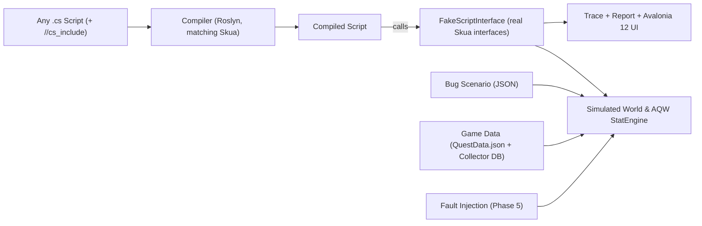

# Plan — Offline Test Environment for Skua Scripts ("SkuaSim")

## Objective
An **offline, reproducible, standalone, and detailed** test environment where **any Skua/VibeSkua script** (Army, Core*, Farm, Story, Daily, Ultra, etc.) can be compiled and executed against a **simulated game state**. When a bug report arrives, developers can reproduce the user's exact scenario independently (with zero AI dependency), inspect every API call step-by-step, and verify the fix.

> [!IMPORTANT]
> This does **not** recreate AQW or use Artix Entertainment's assets or servers. Scripts only interact with the game through the Skua API (`IScriptInterface` and related interfaces), so we only need to simulate **that API** and a lightweight in-memory world behind it.

## Architecture

### Components
| # | Component | Status | Description |
|---|---|---|---|
| 1 | **Collector (`SkuaSim.Collector`)** | ✅ Done (v1) · 🔄 Phase 3.5 corrections | Passive plugin for VibeSkua/Skua that captures maps, cells, monsters, combat damage (`ct.sara[].actionResult`), HoT/DoT (`typ: "d"`), auras & stack counts (`stk`), skill animations (`animStr`), zone events, drop counts, map items, shops, quests, classes/skills/stats (`sAct`/`stu`), enhancements, Awe/Forge proc rates, and cross-session anonymized `packet_schemas.json` into `gamedata.json` (multi-client safe via global `Mutex`). **Phase 3.5 (revised 2026-11-20):** protocol verification, data-quality bug fixes (monster level never captured, quest rewards misattributed as monster drops), schema v2 with passive official drops, real XP/gold per kill and respawn times — see *Collector Correction & Schema v2 Plan*. |
| 2 | **Loader / Compiler** | ✅ Done | Recursively resolves `//cs_include` directives and compiles scripts with Roslyn against the **real Skua assemblies** (`Skua.Core.*`) in collectible per-run `AssemblyLoadContext`s, rewriting time APIs to the virtual clock (`TimeHookRewriter`). |
| 3 | **FakeScriptInterface** | ✅ Core Done | Implements the Skua interfaces (`Player`, `Map`, `Monsters`, `Combat`, `Kill`, `Hunt`, `Inventory`, `TempInv`, `Bank`, `House`, `Quests`, `Drops`, `Shops`, `Skills`, `Boosts`, `Options`, `Config`, `Wait`, `Send`, `Events`, `Flash`, `Stats`, `Lite`, `Accounts`, `Handlers`, `Servers`, etc.) via `ProxyHub`. |
| 4 | **Simulated World & AQW StatEngine** | ✅ Core Done | 3-tier in-memory game state (Scenario → Collector DB + `QuestData.json` → AST-assisted synthesized fallbacks flagged in reports), authentic AQW `StatEngine` (STR/INT/END/DEX/WIS/LCK, Crit, 50% Haste cap, Dodge, class-skill calibration), real AQW boosted gear catalog (`AqwBoostGearCatalog`), Awe/Forge quest unlocks (`EnhancementUnlockCatalog`), and `2x` consumable/server boosts. |
| 5 | **Virtual Clock** | ✅ Done | `bot.Sleep`, `Wait.For*`, `Thread.Sleep`, `Task.Delay`, `DateTime`, and `Stopwatch` advance simulated time deterministically (`same seed = identical outcome`). Supports minutes, hours, days, weeks, and Unlimited (`0`) virtual & real execution limits with multi-day clock formatting (`Xd hh:mm:ss.fff`). |
| 6 | **CLI (`skuasim.exe`)** | ✅ MVP Done | Standalone offline executable: `skuasim db-stats`, `skuasim compile <script.cs>`, `skuasim run <script.cs> --scenario <file.json> --seed 42`. |
| 7 | **Visual UI (`SkuaSim.UI`)** | ✅ Done | Standalone Avalonia 12 desktop dashboard ("Skua without Flash") with adaptive multi-resolution scaling (`Auto`, HD–8K), standardized typography, responsive splitters, live client/AQW combat state, databank class & live stats preview, real AQW boosted equipment picker, Awe/Forge enhancement checklists (with master + per-category `All Weapon`/`All Helm`/`All Cape`), Skua-faithful `Script Options` (`CheckBox` booleans, `MultiOptions` tabs, headers, `Reset Defaults`, `Load Skua .cfg`), color-coded Logs/Errors/Trace (Violet for Synthesized data), and `.md`/`.json` export. |
| 8 | **Multi-Client (Army)** | 🔜 Next (Phase 4) | Up to **20 concurrent simulated players** (`1–20` accounts) sharing rooms, monster HP pools, party buffs/auras, `Goto`/cell tracking, and Army sync files (`*.sync`, `character_locations`, `army-control-jump.json`) on synchronized virtual-clock threads. |
| 9 | **CoreBots CBO, Skua Runtime Options, Live Swaps & Potions** | 🔜 Next (Phase 4) | Scenario-driven `CoreBots.cs` (`CBO_Storage`) + functional `Bot.Options`/`Bot.Lite` overrides (`Solo`/`Farm`/`Dodge`/`Boss` classes & gear, `DisableBestGear`, `DisableAutoEnhance`, `RestCheck`, `PrivateRooms`/`PublicDifficult`, `BankMiscAC`, `ActionDelay`/`HuntDelay`, `AcceptACDrops`, `AggroMonsters`, `SafeTimings`, `HuntPriority`, `ReacceptQuest`), real-time live class & enhancement swaps (`Core.EquipClass`, `Adv.EnhanceItem`), and full Potion/Elixir/Tonic/Scroll simulation (for `UltrasLW` and endgame scripts). |
| 10 | **Fault Injection & Asserts** | 🔄 Phase 5 in progress · ✅ no-progress detector, scenario faults, scenario asserts + `skuasim test` (2026-11-24) | Disconnects, lag spikes, full rooms, failed `Join`, quest failure, dry drop streaks, infinite-loop/regression detection, declarative scenario `asserts`, diagnostic file generator, and bug report templates. |
| 11 | **Replay & Public Release** | 🔜 Planned (Phase 6) | Real session log replay, official Skua parity pass, CLI `--skua-*` flags + `init-scenario`/`merge-data`, baseline starter DB, open-source license, and packaged releases. |

## Game Data Sources (Fidelity)
- **`QuestData.json`** (already available in VibeSkua/Skua): quest definitions, requirements, and rewards.
- **Passive Collector Plugin (`SkuaSim.Collector`)**: runs passively inside VibeSkua/Skua during normal use and saves anonymized maps, cells, monsters, combat telemetry, class skills, observed drop rates, map items, shops, and quests into `gamedata.json` (plus anonymized structural packet samples in `packet_schemas.json`).
- **Automatic Fallbacks**: when data is missing, the simulated world generates plausible defaults (synthesized monsters, AST-inferred targets/shop items, 50% default drop rate, etc.) and explicitly flags every synthesized entity in **Violet** in the UI diagnostics and execution reports.

> [!WARNING]
> **Honest Limitations:**
> - **Windows-only:** scripts such as `CoreBots.cs` reference `System.Windows.Forms`, requiring Windows and `Microsoft.WindowsDesktop.App`.
> - **Data fidelity:** simulation excels at catching **script logic bugs** (control flow, conditions, loops, inventory/bank/quest accounting, purchase math — already validated by catching a real infinite-loop bug in `CoreFarms.SwagTokenA`!). Bugs that depend on **exact server timing, Ultra boss aura/zone choreography, or Flash client quirks** require either Phase 4 (Army/Aura combat simulation) or Phase 6 (real session log replay).

## Phases
| Phase | Deliverable | Status | Outcome |
|---|---|---|---|
| **1 — MVP** | Loader + compiler + core `FakeScriptInterface` + virtual clock + trace | ✅ Done | Scripts compile unchanged (tested up to 171 `//cs_include` files) and run deterministically with detailed reports |
| **2 — Data-Driven World** | Import `QuestData.json` + Collector `gamedata.json` + JSON scenario format + AQW `StatEngine` | ✅ Done | Reproduce specific user states (level, class, real AQW boosted gear, Awe/Forge unlocks, boosts, quests) |
| **3 — Visual Interface (`SkuaSim.UI`)** | Avalonia 12 desktop dashboard ("Skua without Flash") + UX & Collector protocol polish | ✅ Done | Multi-resolution UI (HD–8K), live client/stats state, real AQW gear & enhancement editor, Skua-faithful `Script Options` + `.cfg` import, unlimited virtual & real execution limits, color-coded Logs/Diagnostics/Trace, and `.md`/`.json` export |
| **3.4 — Simulator Robustness** | `KillQuest` AST hints + on-demand monsters on synthesized maps, no-progress (`Stalled`) detector, process-stable hashing + cross-process determinism test, `CLAUDE.md` | ✅ Done (2026-11-20) | Infinite loops on uncaptured maps (e.g. `/lair`, 38 virtual hours) now finish or stop as `Stalled` within the configured virtual time |
| **3.5 — Collector Corrections, Schema v2/v3 & Real Rewards (`SkuaSim.Collector`)** | Protocol verification sampling, monster level/race fix, drop attribution fix, schema v2 with backup, quest-gated `EligibleKills`, passive `monsterDrops`, quest-gated map items, quest reward types, schema v3: real XP/gold/rep per kill, respawn times, quest-set kill counting, room occupancy | 🔄 In progress (Steps 1–4 done, Step 5 items 16–18 done; item 19 left) | Simulator stops inventing monster levels, XP/gold and respawn timers, and stops rolling drops that are actually quest rewards |
| **4 — Multi-Client (Army), Live Loadouts, Potions & Boss/Aura Combat** | Up to 20 concurrent clients, `Solo`/`Farm`/`Dodge`/`Boss` role classes + live class/enhancement swaps, Potions/Elixirs/Tonics/Scrolls (`UltrasLW`), and active aura/zone/Ultra boss combat | 🔜 Next | Test Army scripts (`ArmyFarmerJoeDoAll.cs`), `UltrasLW` potion/taunt teams, and dynamic CBO class/enhancement switching end-to-end |
| **5 — Faults, Asserts & Bug Templates** | Fault injection (lag/disconnect/drop droughts), scenario `asserts`, diagnostic generator & bug report template | 🔄 In progress (faults ✅, asserts + `skuasim test` ✅ 2026-11-24; diagnostic generator and bug template left) | End-to-end workflow: "bug → scenario → reproduce → fix → automated regression test passes" |
| **6 — Replay, OMNISCOPE Unification & Public Packaging** | Real session log replay, official Skua parity, OMNISCOPE SWF/Cross-Ref integration (`wtffidy/VibeSkua`), CLI flags (`merge-data`, `init-scenario`), and release bundle | 🔜 Planned | Reproduce server-dependent edge cases, unify offline map/drop/combat intelligence with OMNISCOPE, and distribute cleanly to external developers |

## Collector Correction & Schema v2 Plan (Phase 3.5 — revised 2026-11-20)
Revised after a data-quality audit of the live `gamedata.json` (13.7k flushes, 821 monsters, ~99k kills) and a review of the OMNISCOPE prompt against the read-only `auqw/Scripts` generator helpers (`DropPacketCollector`, `QuestPacketCollector`, `LocationSwfQuestReader`).

**Audit findings that drive this plan:**
- **Monster level is never captured:** `Level = 0` on all 821 monsters and all 2,666 map spawns. Spawns only come from the live `Bot.Monsters` snapshot (which has no level); the `moveToArea` parser looks for `monbranch`/`intLevel`/`strRace` and has never matched a real packet (likely `monBranch`/`iLvl`/`sRace`, to be confirmed). The unit test passes because it uses an invented packet with the same wrong keys. Consequence: the simulator invents monster levels and computes XP per kill from the *player's* level.
- **Quest rewards are attributed as monster drops:** a `dropItem` within 5 s of a kill (or with no kill at all, via a "first monster in cell" fallback) is credited to a monster. 49 drops on 37 monsters have more drop events than kills (e.g. *Fighter Helm* ×2,953 on *Skeletal Warrior* with 2,329 kills).
- **Quest-gated drop rates are diluted:** 82 drops are below 1 % (e.g. 0.04 %) because every kill counts, quest active or not.
- **Not captured at all:** real XP/gold/class points/reputation per kill (`addGoldExp`, confirmed handled by Skua), per-monster respawn time (simulator uses a fixed 12 s), room `MaxPlayers`.
- **`monsterDrops` has no drop rates:** the official list (`ItemID`, name, `bTemp`, `questGated`, `questObjective`) complements observed rates, it does not replace them. Requests are cell-scoped and `items` arrives either as an array or as an object keyed by ItemID.
- **Modeling:** class combat stats mix all levels and gear (VHL 62 % crit from endgame gear is blended into any VHL scenario); the enhancement profile captured only 1 pattern and is unused by the simulator.

**Step 1 — Protocol verification (sampling only; nothing written to `gamedata.json` changes):** ✅ Done (2026-11-20)
1. ✅ Allowlisted protocol packets sampled into `packet_schemas.json`; personal packets (inventory, bank, friends, chat, login, the player's house) are never sampled; `CharItemID`/`iQtyNow`/`bBank` are redacted.
2. ✅ Command census (names and counts only) + value-free skeletons for unknown commands.
3. ✅ Session played (incl. WeeklyReleaseGeneratorV3 and MergeTemplateHelperV3). **Verified protocol facts:**
   - `moveToArea`: `mondef` { `MonID`, `strMonName`, `intLevel`, `sRace`, `strMonFileName` }, `monmap` { `MonMapID`, `MonID`, `strFrame`, `intRSS` (always `-1`, not a respawn time) }, **`monBranch`** (capital B) { `MonMapID`, `MonID`, **`iLvl`**, `intHP`, `intHPMax`, **`wDPS`** }. No room player cap in this packet.
   - `addGoldExp`: { `typ` (`"m"` monster / `"q"` quest), `id` (MonMapID, monster only), `intExp`, `bonusExp`, `intGold`, `bonusGold`, `iRep`, `bonusRep`, `FactionID` } — the totals **include** the bonus (e.g. `intGold` 2500 with `bonusGold` 1500 = base 1000; `intExp` 625 with `bonusExp` 125 = base 500); `intExp` is `0` at level cap. No class-point key has been observed.
   - Monster respawn arrives as the **string** packet `["respawnMon", "-1", "<MonMapID>"]` (~1 per kill; second element is the room ID); `mtls` { `id`, `o` { `intHP`, `intState`, `intMP` } } carries monster state updates.
   - The client does **not** expose the room player cap: `world.areaData.intMaxPlayers` was missing in all 58 probes. Skua's `Bot.Map.PlayerCount` gives the current occupancy.
   - Items in `dropItem`/`addItems`/`monsterDrops` carry **`sReqQuests`** (IDs of the quests that use the item) — a passive quest-gated signal.
   - `getQuests` rewards: `reward[]` { `ItemID`, `iQty`, `iType`, `iRate` } + `oRewards` item definitions (e.g. `itemsS`).
   - `monsterDrops` { `MonMapID`, `items` keyed by ItemID with `questGated[]`/`questObjective[]` (quest **names**), `sReqQuests`, `bTemp` } — no drop rates.
   - `ccqr` { `QuestID`, `bSuccess`, `rewardObj` { `intExp`, `intGold`, `iCP`, `iRep`, `FactionID`, `intCoins` } }.

**Step 2 — Data bug fixes (using the confirmed keys):** ✅ Done and deployed (2026-11-20)
4. ✅ `moveToArea` parsed with the real keys (case-insensitive, old guesses kept as fallbacks): monster/spawn level from `monBranch.iLvl` (fallback `mondef.intLevel`), race from `sRace`, plus new `WeaponDps` from `wDPS`.
5. ✅ Drop attribution: only the monster killed in the last 5 s is credited (no "first monster in cell" fallback); items arriving within 3 s of a quest turn-in (`tryQuestComplete` / `ccqr`) that are rewards of that quest — or whose quest rewards are unknown — are excluded. `getQuests` rewards are now parsed with `RewardType`/`RatePercent` (also fixes item 12's data source).
6. ✅ Collector test 8 uses real anonymized packets (chaoscrypt `moveToArea`, Elders' Blood `getQuests`, real `dropItem`/`ccqr`/`addItems`).

**Step 3 — Schema v2 (`SchemaVersion: 1 → 2`):** ✅ Done, deployed and live data migrated (2026-11-20)
7. ✅ `GameDatabaseStore` copies a v1 file to `gamedata.v1-backup-<UTC>.json` and migrates it on the next flush (`GameDatabaseMigrations.MigrateToV2`, logged in `MigrationLog`). **Cleanup rules, revised after a dry run on the live data:** only provably wrong records are deleted (52 drops with more drop events than kills). Removing "quest-reward-only" items was dropped — the dry run showed it would delete real drops that are also quest rewards (e.g. Shurpu Blaze Token from Xan, ~78 %). Live data: 1,080 drops kept, 369 temporary quest-required drops marked quest-gated (`unverified`); backup `gamedata.v1-backup-20261120-203127.json` + a manual copy in `SkuaSim\backups\`.
8. ✅ Quest-gated precision: drops carry `QuestGated`, `RequiredQuestIds`, `QuestGatedNames`, `QuestObjectives`, `TrackedDropEvents` and `RateBasis` (`all_kills` / `quest_active_kills` / `unverified`); monsters carry `TrackedKills` and `KillsWhileQuestActive`. Rates are derived in one place (`DropRates.Recompute`) and `EstimatedDropChance` is **null** when there is no trustworthy measurement. The active quest list comes from `Bot.Quests.Active` (RAM only) and nothing is tracked until it is known. Gating follows the server: `sReqQuests` is set for **temporary** quest-required items only (verified on live samples), so the migration marks only temporary items.
9. ✅ Official drops captured passively from `monsterDrops` (items keyed by ItemID or as an array): `IsOfficialDrop`, quest-gated flags and names; observed counts and rates untouched. No active request mode was added.
10. ✅ ~~Room `MaxPlayers` from `world.areaData.intMaxPlayers`~~ — probe always missing; replaced in v3 by peak occupancy (item 15).
11. ✅ Quest-gated map items: `RequiredQuestIds` (from the granted items' `sReqQuests`), `GrantObservations` and `ActiveQuestCounts`.
12. ✅ Quest reward types: `RewardType` (`iType`) and `RatePercent` (`iRate`) on quest rewards (done in Step 2).
- ✅ Simulator side (needed so v2 data is safe to consume): quest-gated drops only drop while one of their quests is active; a known drop without a trustworthy rate uses `World.GenericDropChance` with a Violet `droprate:` warning instead of 0 %. Collector tests 9/9, Core tests 14/14.

**Step 4 — Missing data, schema v3 (`SchemaVersion: 2 → 3`):** ✅ Done and deployed (2026-11-21); live migration happens on the first flush
13. ✅ Per-kill rewards from `addGoldExp` `typ: "m"` → `CapturedMonster.KillRewards`: base XP/gold/rep (total − bonus), min/max/average, `FactionIds`; `0` values (max level / gold cap) are counted in `ZeroExpSamples`/`ZeroGoldSamples` and never averaged. Quest (`typ: "q"`) rewards are not recorded here. Class points: no key observed, not parsed.
14. ✅ Respawn time = kill → `respawnMon` for the same MonMapID (samples outside 0.5 s–10 min discarded; one sample per death) → `CapturedRespawnStats` on the map spawn and on the monster (`Samples`, `MinMs`, `MaxMs`, `AverageMs`).
15. ✅ Room cap: the client path does not exist, so the probe was removed. Maps now store `PeakPlayersObserved` (from `Bot.Map.PlayerCount` on join and every flush; a count, never names), a **lower bound** of the cap, plus `PlayerCountSamples`.
- ✅ Fix: quest-gated denominators double-counted kills made with several required quests active (the per-quest counts were summed). Kills are now keyed by the exact active quest set (`KillsByActiveQuestSet`, e.g. `"8814,8815,9172"`) and a drop's eligible kills are the sum over sets that contain any of its quests. Legacy v2 per-quest counts are frozen and contribute their **maximum** (a lower bound).
- ✅ Migration v2 → v3 (`GameDatabaseMigrations.MigrateToCurrent` runs v1→v2→v3): dated `gamedata.v2-backup-<UTC>.json`, nothing deleted, quest-gated rates recomputed. Dry run on the live data: 24 monsters recomputed, file 7.6 → 8.4 MB (new empty fields). Collector tests 10/10 (test 10 uses real `addGoldExp`/`respawnMon` shapes).

**Step 5 — Quality & infrastructure (collector 1.1.0, 2026-11-22: items 16–18 done, tester release prepared):**
16. ✅ Class combat and stat snapshots split by 10-level band, class rank and enhancement signature (`CapturedClassProfile.CombatByProfile` / `StatsByProfile`, key `L91-100|R10|W9:100|C9:100|H9:100|K9:100`; additive v3 fields). The simulator blends observed crit/dodge/damage/heal only from a compatible profile (`World/ClassCombatProfileMatch.cs`: exact key, else same band + same patterns + rank group 1–3 / 4–9 / 10); the legacy all-gear aggregate `Combat` is kept but no longer blended. Old data has no profiles, so blending restarts from new sessions.
17. ✅ The per-pattern "pure set" enhancement profile is no longer recorded (old data kept); `StatsByProfile` holds the real stats with every slot's pattern and level, which the stats review (Next item 4) can use.
18. ✅ No built-in mirror: the OneDrive/Desktop default is gone; mirrors come from the Mirror File Path option or `mirror_paths.txt` next to the primary file (a local, per-PC file).
19. Resolve `monsterDrops` quest **names** (`questGated`) to quest IDs when `sReqQuests` is empty, so those drops can leave `unverified` (not urgent: the names are already stored).
- ✅ **Tester data flow:** `GameDatabase.CollectorVersions` (flushes per collector build, e.g. `1.1.0+19e923d`); plugin **Export for Sharing** (`GameDatabaseStore.ExportForSharing`: dates cut to the day, migration log dropped, random per-install contributor ID in `contributor_id.txt`, `packet_schemas.json` included); `skuasim import-data <zip>` (`Data/GameDataContributions.cs`: rejects own exports, ID-less files, newer schemas and older exports of a stored contributor; stores `data\contrib\<id>.json`); every catalog load merges `data\contrib\*.json` into `gamedata.json` in memory in file-name order (`GameDataCatalog.Contributions`, listed in the trace and `db-stats`). Guide: [docs/COLLECTOR_TESTERS.md](docs/COLLECTOR_TESTERS.md). Core test 18, Collector tests 3/4/10 extended.
- ✅ **PvP:** `GameDatabase.Pvp[map]` from `PVPE` (event counts `team0:kill:Restorer`, player name never read) and `PVPS` (score updates, the final score of each match — scores dropping back or leaving the map ends it — and the ordered event/score sequence, capped at 2,000), to work out the k/m/r/v score keys and the trophy rule.

**Phase 3.6 — The simulator consumes the real data, AE calendar & server resets:** ✅ Done (2026-11-21)

*Findings from the v3 live session that shaped it:* base gold per kill = **3 × monster level** and base XP = **10 × level** on every measured monster of level 1–90 (level-255 event monsters do not follow it); respawn is **~2.4 s** (1.6–3.0 s, 269 samples) vs. the fixed 12 s the simulator used (Artix's [combat update](https://www.artix.com/posts/aqw-combat-improvements/) says "about 3 to 5 seconds"); `wDPS` is **not** a direct damage value (observed hit / wDPS ranges 0.55–3.7, level-dependent); the simulator never granted reputation at all and its rank table was wrong (rank 10 = 100,900 instead of AQW's 302,500); quest reputation/class points are not in `QuestData.json`, only in `ccqr.rewardObj` (base values); accept requirements ignored the house inventory (45 quests need a house item, e.g. Prime Fiend Shard → 9555); dailies never reset; the +100 % gold bonus seen on 2026-11-20 was the AE calendar's "Double Gold Boost 11.20.26", not membership.

*Collector (additive v3 fields, no migration):* `CapturedQuest.ObservedReward` from `ccqr.rewardObj` (`intExp`, `intGold`, `iRep`, `FactionID`, `iCP`, `intCoins` — base values, verified against `addGoldExp`), and `GameDatabase.Factions` (ID → name from `addFaction` and `Bot.Reputation.FactionList`; the player's rank/rep and `CharFactionID` are never stored). Collector test 10 extended.

*Simulator:*
1. ✅ **Respawn:** scenario `world.monsterRespawnSeconds` (now optional; removed from the sample scenarios) > spawn average > monster average > median of measured monsters (Violet) > official ~4 s (Violet).
2. ✅ **Kill rewards:** measured base XP/gold > rule 10×/3× level (Violet), boosts applied on top, gold capped at 100,000,000; reputation per kill when measured for a single faction; class points per kill stay an estimate (Violet, no packet carries them).
3. ✅ **Reputation:** new `GainReputation` (scenario faction > collected name > `Faction #id` Violet), correct rank table `(5·r·(r+1))²` (900 … 302,500), quest rep/CP from `ObservedReward` (Violet note for quests never turned in while collecting).
4. ✅ **House items:** accept requirements count inventory + bank + **house**; the failure message names house items.
5. ✅ **`GetMapItem`:** a captured map item with `RequiredQuestIds` gives nothing unless one of those quests is active (logged).
6. ✅ **Monster damage without combat data:** `wDPS` × the median hit/wDPS ratio of measured monsters within ±10 levels (Violet), then the old level formula.
7. ✅ **Captured quests missing from QuestData:** built from the collector's requirements/rewards (`RatePercent`) and observed base reward instead of an empty quest.
8. ✅ **Start date & server resets:** scenario `startDate` (UTC; default 2026-01-01 12:00 UTC), daily reset 00:00 US Eastern, weekly on Friday, monthly on the 1st (from VibeSkua.Manager: "Daily Reset (00:00 EST)", "Weekly Reset (Fri 00:00 EST)"); quest `Field` `id*`/`iw*`/`im*` decides the period. Report shows the start (UTC + server time) and resets crossed.
9. ✅ **AE calendar:** `skuasim calendar-update` downloads the public https://www.artix.com/calendar/ (the same source as VibeSkua's Calendar tool) into `data\ae_calendar.json`: events with start (`?d=` value, Eastern) and duration read from each boost's page ("72 hour DOUBLE Gold…"; cached on later updates); `calendar-show [--date]`. Scenario `boosts.aeCalendarServerBoosts` (UI checkbox, CLI `--ae-calendar`) applies the double XP/gold/rep/CP active at the virtual time; outside the file's coverage nothing is applied and a warning is shown. The simulator only reads the local file (offline, deterministic; the report shows the file's fingerprint). Resource boosts (Legion Token, Void Aura, Blood Gems…) are recorded but not simulated yet.
10. ✅ UI: "Virtual Start (UTC)" field and "AE Calendar Server Boosts" checkbox. CLI: `--start-date`, `--ae-calendar`, `--calendar`. Core test 15 (fixture data + a real calendar excerpt).

11. ✅ **Reward sources & boost stacking (user rules, 2026-11-21):** XP from quests and kills; class points from kills; gold from quests, kills and **selling** items; reputation from quests. Boosts **add up**: highest gear bonus of the type (same-type gear never stacks) + consumable +100 % + server +100 % — e.g. 1000 rep + server boost = 2000; 1000 XP + XP boost + Awe-scended armor (+50 %) = 2500 (`RewardBoosts.Combine`, also in the editor preview). Matches the live sample 210 gold → 525 (server +100 %, gear +50 %). Selling a gold item now returns 25 % of its shop price (flagged rule until the `sellItem` response is verified; AC items return nothing yet). Kill reputation and quest class points are applied only if the collector ever measures them (never seen so far).
12. ✅ Collector: key-name census per command (`keys:<cmd>:<keys>` in `CommandCounts`, names only) and a full sample category still accepts a never-seen key set, so a new field (e.g. a class-points key) cannot be hidden by per-map samples; `sellItem` sampled for the sell-back value (`intAmount`, `bCoins` verified from its skeleton); `levelUp` { `intLevel`, `intExpToLevel` } recorded as AQW's real XP table (`GameDatabase.XpToNextLevel`), used by the simulator when known (estimate flagged otherwise). **CP found (2026-11-21):** kills of a class below rank 10 carry `iCP` + `bonusCP` in `addGoldExp` (Arctic Wolf lv 15: 150 XP, 45 base gold, 305 CP); recorded per monster in `KillRewards` (`CpSamples`, `AverageBaseCp`) and used by the simulator (estimate flagged otherwise; one sample is not enough for a level rule yet). Sales: the client `sellItem` request (item ID) is paired with the server response (`intAmount`) into `GameDatabase.SellPrices`; the simulator uses the measured amount, else the median sell/price ratio of measured items, else 25 % (flagged). **Verified:** gold items sell for **25 %** of the shop price, rounded up (20 items, e.g. 200,000 → 50,000; Peasant Rags 2 → 1); AC items: public AQW rule (confirmed by the user, 2026-11-22) — **90 % within 24 h of purchase, 25 % afterwards**, rounded up; the simulator tracks the virtual purchase time (items owned at start count as old) and ignores measured AC amounts (they depend on the purchase time the collector cannot see). CP per kill varies for the same monster (Arctic Wolf lv 15: 330–355, avg 346 over 182 kills; Frost Spirit lv 255: 255–405) while XP/gold do not, so CP likely depends on the character (level/rank) — the per-monster average is used. Overnight data (2026-11-22, ~9.5k CP kills): average ~410 and the same 104–455 range on monsters of level 15–255 while an account leveled 11 → 40, i.e. CP does not grow with monster level; **Resolved (2026-11-22):** AQW Wiki rule *CP = 230 + 25 × class rank* (all observed values 255–455 are ranks 1–9; rank 10 earns none), monster level only matters as a penalty when it is below the character — official 2018 note: -5 %/level, none at 20+ ([aq.com](https://aq.com/gamedesignnotes/aqw-patch-notes-7079)); the wiki says -10 %/level from 11 levels. **Penalty verified 2026-11-22** (Shaman rank 1 → 10, monsters lv 5–255): 100 % up to 10 levels below, -10 %/level from 11 levels, 5 % floor, rounded up (`SimWorld.ClassPointsGapRatio`, no longer synthesized). Collector keeps `CpByRankAndLevelGap` / `CpByPlayerLevel` for validation. XP table so far: 11 → 4,600, 12 → 5,450, 13 → 6,450 (the old estimate gave 4,125 / 4,800 / 5,525).

*Not done / limits:* house items are edited in the scenario JSON (`"house": [...]`), like inventory and bank (the editor has no item lists yet). The class rank is one value for the character, not per class (a CoreBots Solo/Farm/Dodge/Boss swap keeps the rank — Phase 4 live class swaps).

**Known data limitations after v2:** v1-era quest-reward contamination that is not provably impossible is kept (not separable); permanent quest items (e.g. Mystic Quills 0.04 %) keep a diluted all-kills rate because the server does not flag them in `sReqQuests`.

**Explicitly deferred:** consumables (Phase 4); map SWF extraction, NPCs, quest IDs from SWF and the explorer UI (Phase 6 / OMNISCOPE).

## Next Implementations (in order) & Open Decisions
**Next, in order:**
1. ~~**Confirm the CP level-gap penalty**~~ — done 2026-11-22 (Shaman rank 1 → 10 in icestormarena): 100 % up to 10 levels below, -10 %/level from 11, 5 % floor (gap 15 = 50 %, 20+ = 5 %), rounded up — the AQW Wiki rule; the 2018 note (-5 %/level) does not match. Keep collecting (XP table, quest `ObservedReward`).
- ✅ **First real-scenario validation (2026-11-22):** `scenarios/shaman_rankup_lv100.json` + `Tools/RankUpEquippedClass.cs` (level 100, Shaman rank 1 → 10, `icestormunder` Frost Spirit): 740 kills, 31.5 virtual minutes, kills per rank 4/10/21/38/61/90/126/170/220 = exactly the AQW rule. It exposed a simulator bug: the class-rank CP table was wrong (rank 4 = 9,000 … rank 9 = 108,000; real 10,000 … 202,500) — fixed to the same `(5·r·(r+1))²` table as reputation. Pending: compare the virtual time with a real timed run.
- ✅ **Leveling validation (2026-11-22):** `scenarios/leveling_lv1_maxxp.json` + `Farm/Leveling.cs` (level 1, XP boost + server boost + Empowered Higure = 3.35×): every kill gives exactly 10 × monster level × 3.35 (Frost Spirit: measured 600 × 3.35 = 2,010) and the script follows the character level room by room (oaklore 1–9 → portalundead 10 → swordhavenundead 11–19 → icestormarena r7/r10/r11/r16 20–60 → battlegrounde 61–74 → icestormunder 75+). The full AQW XP table (AQW Wiki, `World/AqwXpTable.cs`) replaced the old estimate — it matches all 33 levels captured from `levelUp`. **Gap found:** `battlegrounde` and `portalundead` are uncaptured; the synthesized monster in battlegrounde caused 2,385 of 2,944 deaths — collect those maps.
- ✅ **Complete equipment (2026-11-22):** scenario `player.completeEquipment` (default `true`, editor checkbox "Complete Equipment"): empty Weapon / Helm / Cape slots (and an unenhanced class) get basic gear enhanced at the character's starting level with the class pattern (Wizard for casters, Lucky for melee, or the best unlocked Awe/Forge), flagged `gear:complete`; scenario items are never changed; pets are only created for a boost; a weapon is always ensured, even when disabled. Gear is not re-enhanced as the character levels up during a run.
- ✅ **Manual-test candidate (2026-11-22):** `scenarios/sandsea_rep_lv100.json` + `Farm/REP/SandseaREP.cs` (one map, sandsea/Enter, quests 916/917/919/921/922, everything already collected): Sandsea rank 1 → 10 in 303 turn-ins (303 × 1,000 rep), ~596 kills, ~17.5 virtual minutes, no deaths. Fixed on the way: `Bot.Reputation.GetRank` answered rank 10 for a faction the character has no reputation with (made rep farms exit at once) — now rank 1, flagged `factionrank:`; Complete Equipment no longer creates a cosmetic armor (the class is the stat armor slot).
- ✅ **Bug fixed by a user test (2026-11-22, `Story/LordsofChaos/02Escherion(ChiralValley).cs`):** the quest watcher auto-completed every *active* quest instead of only those registered with `Bot.Quests.RegisterQuests`, stealing the turn-ins of scripts that call `EnsureComplete` themselves (map items and single quest drops vanished → infinite Chainsaw Sneevil loop). Now only registered quests auto-complete (as in Skua); the story completes 26/26 quests in ~8 virtual minutes. Also: no cosmetic armor/pet is created for Awe/Forge unlocks, and the `questrep:` note explains the quest itself works normally.
- ✅ **Boss + quest-item fixes from the same user test (2026-11-22):** monsters being fought now report AQW state 2 (`SimMonster.State`; `CoreBots.KillEscherion` switches to the staff on it); new `World/BossMechanics.cs` (Escherion takes no damage while the Staff of Inversion lives); a temporary item that QuestData quests require only drops while one of them is active even if the collector recorded it as a normal drop (its all-kills rate is diluted — "Defeated Escherion" 5/1,040 — so a flagged chance is used instead). The Escherion story now kills the staff, then Escherion, and ends (26/26 quests, ~5 virtual minutes).
2. ~~**Random seed by default**~~ — implemented, then **dropped by the user (2026-11-22)**: AQW answers within the same patterns (monster damage around its average, changed only by effects such as "-X % damage"); randomness that matters for validating a script is mostly drops (low % items, "Supplies to Spin the Wheel"-style reward rates). The default stays fixed (`SimulationRunner.DefaultSeed` = 42); typing another seed tries a different drop luck, and a seed can be drawn on request (UI **Random** button next to the Seed box, CLI `--seed random`) — it stays in the box and is shown in the report, so that run can be repeated. The seed is written in the trace header; the redundant `"seed": 42` was removed from the sample scenarios (same as the default).
- ✅ **Other small items (2026-11-22):** AC items sell back 90 % within 24 h of purchase, 25 % after (public rule, user-confirmed); start at the PC's current time (`startAtCurrentTime`, CLI `--start-date now`, editor "Use PC time"; the report prints the resolved start); **Export Scenario** (`SimWorld.ExportScenario`, report `EndScenario`, CLI `--export-scenario`, Diagnostics "Export Scenario"): the character at the end of a run (level, XP, gold, ACs, class/rank/CP, inventory/bank/house/temp items with enhancements and equipped state, reputation, quest progress, location) becomes a new scenario starting at the end's virtual time, so scripts can be chained; gear is exported exactly as it is (no hidden re-enhance); new scenario fields `player.xp`, `player.classPoints`. Collector: a login (`loadInventoryBig`, content never read) or a username change on the same client resets the RAM-only level/class/rank, so kills right after an account switch are not keyed with the previous account's level (each Skua client runs its own collector; class swaps were already tracked through `updateClass`). Checked: `Farm/Leveling.cs` never re-enhances (the `OnEquipClass` auto-enhance hook is commented out in CoreAdvanced), so keeping the starting enhancement is the script's real behavior.
3. ✅ **Background-thread determinism (found and fixed 2026-11-22):** the same seed does not always repeat a run of a script with background threads — `Farm/Leveling.cs` with a frozen `gamedata.json` and seed 172973672 gave 1,120,206 vs 1,118,136 gold after 60 virtual minutes. CoreBots handlers run on other threads, and their API calls at the same virtual instant interleave in a different order each run (visible in the trace from 2.2 s), so `ctx.Rng` draws can change order. Core test 13 passes because its script has no background threads. ✅ **Fixed 2026-11-22 — managed flows** (`Runtime/SimClock.Flows.cs`): the compiler rewrites the script's `Task.Run` → `SimHooks.Run`, `Task.WaitAll/WaitAny` → virtual-time waits that keep the clock moving, and `new Random()` / `Random r = new()` → a Random seeded from the run seed (CoreBots' quest watchdog uses one). Only one script thread runs at a time: a flow runs when the main thread advances past its wake-up time (time, then creation/yield order), `await Task.Delay` inside a flow waits in place and hands the turn back (a cancelled token wakes it at once), await continuations come back as new flows (`SynchronizationContext`), a flow polling without sleeping yields 250 ms every 500 API calls, and when the script ends the pending flows are cancelled. Fallback, reported as a warning: a flow blocked 2 s of real time on something outside the simulator, or waiting while the main thread is blocked (e.g. `task.Wait()`), runs free. Verified with a frozen `gamedata.json`, each run twice: Leveling (60 virtual min), Escherion story (26/26), SandseaREP (303 turn-ins), RankUpEquippedClass (740 kills) — identical traces, no flow detached; Core test 16 checks the interleaving. Core test 1's safety cap was raised (it relied on the old race to turn the quest in after one kill). Still free-running (rare in scripts): `new Thread(...)`, `Task.Factory.StartNew`, timers, and `.Wait()`/`.Result` on a task from the main thread (falls back after 2 s).
- ✅ **Quest pets & unlock items (2026-11-22, user request):** 946 of 10,345 QuestData quests have accept requirements (317 a quest pet, 188 pets; also weapons, classes, armors, house items); CoreLegion/CoreNation choose whole paths with `Core.CheckInventory("<pet>")` (Paragon Pets → Legion Token quests, Bounty Hunter's Drone Pet, Drudgen the Assistant…). Done: `Data/QuestUnlockCatalog.cs` (item → quests → rewards; stackable requirements such as Legion Token excluded); report section "Paths That Depend on Items the Character Does Not Own" (`SimWorld.Unlocks.cs`, fed by inventory/bank/house queries and failed accepts); **AQW rule (user-confirmed): accept requirements and turn-in items must be in the inventory** — the bank no longer counts, house items count from the house; `Bot.Quests.IsAvailable` now follows Skua's own checks (auqw/Skua `ScriptQuest.IsAvailable`: daily, unlocked, member, level, class points, faction rep, accept requirements in the inventory); **`world.getQuestValue` implemented** (it returned 0, so every `Core.isCompletedBefore` answered "no" — e.g. a Legion member was sent to redo the Legion entry PvP); editor panel "Quest Pets & Unlock Items" (search by item or by what it unlocks, saved to the scenario inventory); `skuasim whatif <script> --add "<item>"` (same seed, with/without; Legion Token farm 20 min: 790 → 1,250 tokens with the Shogun Paragon Pet); user-run `SkuaSim_ExportMyAccount.cs` on the user's Desktop (level, class, member, gold, owned unlock items, quest-slot progress, reputation; no account name) — its output reproduces the pet path in the simulator. Core test 17. Not covered: scripts that read `Bot.Inventory.Items` directly (e.g. CoreLegion's pet-ID table) are not listed in the report section, but the simulation itself still follows their path.
4. **Phase 3.5 Step 5** — ✅ class combat stats by level/gear, enhancement profile, mirror path and the tester data flow (collector 1.1.0); ✅ enhancement stats from the AQW Wiki tables (`World/AqwEnhancementTable.cs`, 2026-11-22: slot totals by level — weapon 200 / armor and helm 150 / cape 120 at level 100 — and each pattern's distribution; the old pool × 33/25/25/17 % estimate gave 23 % too many points; Forge helm/cape passives and proc buffs as on the wiki, e.g. Valiance ×1.3, Spiral Carve +25 % crit for 10 s, Avarice -35 % resistance; mana and hit chance are not modeled); left: quest-name → ID resolution and the class base stat model (validate with `StatsByProfile`) (class base model + enhancement slot weights: observed ~30/25/25/20 vs 33/25/25/17 used).
- **Legion entry & PvP (next, 2026-11-22):** Legion entry per the AQW Wiki ([Undead Warrior](http://aqwwiki.wikidot.com/undead-warrior-armor): 1,200 AC, sells back 1,080 AC in 24 h / 300 AC after; [Dage the Evil's Quests](http://aqwwiki.wikidot.com/dage-the-evil-s-quests#1): 5 quests, all need it in the inventory, 4th = 200 Combat Trophies from [Bludrut Brawl](http://aqwwiki.wikidot.com/bludrut-brawl), 1–10 per match). Collected 2026-11-22: shops 215/216 (prices match the wiki), maps bludrutbrawl (2 Captains, 6 Brawlers, 8 Restorers, lv 255), battleunderb. `Legion/JoinLegion.cs` currently stalls in the PvP: CoreBots.PvPMove walks with the client packet `mtcid <n>` (move to cell by number), which the simulator ignores, and the collector stores cell names only. Steps: (1) ✅ Collector learns cell number → cell name passively (client `mtcid` paired with the cell the character is in 1.5 s later; `CapturedMap.CellNumbers` votes; `mtcid` reply and `PVPE`/`PVPS` sampled; first sessions 2026-11-22/23: 14 bludrutbrawl cells learned, every event so far is `team0` — the script picks a random room, so the character joins alone and always lands on team 0, and the team-0 own-side cells (`Captain0`, `Resource0*`) are never walked); (1b) collector 1.2.0: one record per match (`CapturedPvpStats.Matches`: final score, events, items received from `dropItem`/`addItems` kept apart, with a 20 s grace window after leaving the map) to work out the Combat Trophy rule from matches with and without the adds killed; (2) ✅ simulator (2026-11-23): `mtcid` moves by the collected cell numbers (unknown number: warning, no move); `World/PvpMatchRules.cs` + `SimWorld.Pvp.cs`: Bludrut Brawl match per join, the Team B Captain's death wins and adds min(10, 1 + Restorers + 2 × Brawlers) Combat Trophies straight to the inventory (AQW Wiki PvP page; verified on 26 collected matches: 7 without the Restorers, 10 with them; the PVPS `k` score equals these points), the legacy captured captain "drop" is not rolled, killed NPCs do not respawn (0 respawns in 377 collected kills); a loss (1 trophy, wiki) is not simulated (solo runs cannot lose). Also fixed on the way: `Flash.GetGameObject("world.myAvatar.objData.intCoins"/intGold/intLevel)` returned 0, so every CoreBots AC purchase failed; the `sellItem` packet (CoreBots.SellItem) was ignored. `Legion/JoinLegion.cs` now completes (level 100, 2,000 AC, `messageBoxAnswer: yes`): 29 matches / 203 trophies, Undead Warrior bought and sold back for 1,080 AC, 5/5 quests, ~1 h 10 virtual. Core test 19. Not done: `dagepvp` (Legion Combat Trophy, different rule, being collected), Frost/Chaos Brawl; (3) ✅ (2026-11-24) a purchase from a shop the collector never captured (free there) is flagged: `accost:<item>` "AC cost unknown" for a known AC item (a real account needs the ACs; CoreBots' "costs X AC" prompt never shows at cost 0) and `currency:<item>` when the item itself was never collected; Core test 20 extended. Note: Core test 8 uses a 20 s real-time limit and can fail right after a build on a loaded machine (seen once 2026-11-24; passes on rerun).
- **AQW Wiki as a data source (approved 2026-11-22, options A + B):** (A) game rules are researched on the wiki during development and coded with the page cited (e.g. AC sell-back 90 % / 25 %). (B) `skuasim wiki-update --from <report>` fetches, one page at a time and only on request, the wiki pages of the items/shops a run had to invent (price, currency, sell-back, shops, purchase requirements) into `data\wiki_cache.json` (cached; `--refresh` to re-fetch); simulations read the local file only (offline, deterministic) as a tier below collected data — **scenario > collected > wiki > synthesized** — and the report marks wiki values. Never the whole wiki; a parse failure skips the item. A prebuilt cache of items used by public scripts can ship with the release.
- **Server warnings (suggested by another Skua dev, 2026-11-24):** the simulator never raises `ExtensionPacketReceived`, so every CoreBots listener for server warnings is dead code in a run (`MapIsMemberLocked` "is an Membership-Only Map", `MapIsNotAvailableListener` "is not available." / "map is locked until event begins", CoreArmyLite `LockedZoneListener` "a Locked zone.", BuyItem `RelogRequieredListener` strMessage "Item is not buyable. Item Inventory full…" / "Quest Complete Failed: Missing Required Item"), and actions the server refuses succeed (e.g. joining a member map as a non-member). The collector had counted ~652k `warning` and ~7.9k `server` packets without their text. Steps: (A) ✅ collector 1.3.0 (deployed EB505D2CFC44): `GameDatabase.ServerMessages` — anonymized templates of `warning`/`server`/`multiLoginWarning` string packets and JSON `strMessage`/`msg` fields (own name `<SELF>`, names of players seen in rooms `<PLAYER>` from RAM only, quoted text `<Q>`, digits `#`), with the client command sent within 3 s before (`cmd:tfer`, `buyItem`…) and the map; messages after whisper/friend/party/slash commands are never stored; Collector test 10 extended. (A2) collector 1.3.1 (deployed 218A9E827D21): `CapturedServerMessage.TargetMaps` — the map requested by a `cmd:tfer` join, so refused joins name the member-only / locked map. First real data (2026-11-24, 19 templates): `Item already in your Bank.` (20k, after getDrop), `Already have a full stack of that item.` (9k), `Please slow down. Last action was too soon!`, `You cannot do that too soon after combat.`, `"<Q>" is an Membership-Only Map.`, `"<Q>" is not available.`, `"<Q>" map is locked until event begins. Get '<Q>' house item from /BaseCamp to unlock.`, JSON `buyItem` strMessage `Item is not buyable. Not enough Gold` / `Not enough Adventure Coins` / `Bag Item Inventory full`, `acceptQuest` msg `success`, server `The battle has been decided! Team A is victorious!`. (B) ✅ simulator (2026-11-24, `World/ServerMessageTexts.cs` + `SimWorld.ServerMessages.cs`): refused joins (member-only: scenario `world.memberOnlyMaps` + collected TargetMaps; scenario `world.unavailableMaps` / `world.eventLockedMaps` for seasonal maps, which change over time) leave the character in place; purchases refused for gold / AC / a full bag (the bag check now happens before paying); pickups refused when the item is in the bank or at a full stack; success packets for buyItem/acceptQuest; the PvP win message. All reach the script through `ExtensionPacketReceived` as `{"params":{"type":"str"|"json","dataObj":…}}`; report section "Server Warnings & Messages"; `Bot.StopAsync` from an event handler only requests the stop (as in Skua). Verified with CoreBots: `Core.Join("lowe")` as a non-member → MapIsMemberLocked stops the bot in battleon. Core test 20. Not simulated yet (no verified rule): the rate limit "Please slow down", "too soon after combat", "Quest Complete Failed: Missing Required Item" (never observed), accept failures. (C) ✅ scenario fault injection (2026-11-24, `Scenario.Faults` + `World/SimWorld.Faults.cs`, Phase 5 started early): `buyDesync` (AE inventory de-sync text, from CoreBots), `questDesync` ("Quest Complete Failed: Missing Required Item", from CoreBots; ccqr shape unverified), `slowDown`, `tooSoonAfterCombat` (collected texts), `disconnect` (logout + AutoRelogin), `joinFail` (silent), `dropDrought` (next N kills drop nothing), triggered by the Nth / every Nth occurrence of `buy`/`sell`/`turnIn`/`accept`/`join`/`pickup`/`loadShop`/`kill`/`any`, optional `target` and `afterMinutes`; never uses `ctx.Rng` (the rest of the run keeps its luck); start-position and relogin joins are not script actions (no faults, no refusals); report section "Injected Faults". Verified with CoreBots: `JoinLegion.cs` + buyDesync on the Undead Warrior → "Inventory de-sync (AE Issue) detected, relogging", bought on retry, 5/5 quests (`scenarios/joinlegion_faults_lv100.json`). Core test 21.
- ✅ **Scenario asserts & regression suite (2026-11-24, Phase 5, done before Phase 4 so the Army work has a safety net):** scenario `asserts` (`Scenario.Asserts`, `Runtime/ScenarioAssertions.cs`) checked from the finished report only — `outcome`, `item` (`in`, `gained`), `questTurnIns`, `questCompleted`, `level`, `gold`, `coins`, `classRank`, `factionRank`, `kills`, `drops`, `deaths`, `virtualMinutes`, `map`, `mapVisited`, `serverMessage`, `scriptLog`, `warning`, `injectedFaults`, `synthesized`, `synthesizedMaps`, `unimplemented`, with `min`/`max`/`exactly`; an invalid assert fails (never passes silently); on a compile error only `outcome` is evaluated. Report section "Scenario Assertions", UI status bar + Errors & Diagnostics, CLI exit code 4 (with asserts the exit code follows them, so an expected `Stalled` can pass). Scenario `script` field (`skuasim run --scenario x.json` without a script) and `skuasim test [files|folders]` (default `scenarios\`, `--report-dir`). Real scenarios turned into tests: `joinlegion_faults_lv100` (11 asserts: faults, relog, retry buy, quests 789–793, sell-back), `sandsea_rep_lv100` (rank 10, 303 turn-ins), `shaman_rankup_lv100` (rank 10, 740 Frost Spirit kills) — 3/3 pass. Core test 22. **Drift seen while baselining (live `gamedata.json`):** Sandsea now takes ~52 virtual min / 1,772 kills (was ~17.5 min / ~596), Shaman 21.7 min (was 31.5) — the asserted behavior is unchanged; **explained 2026-11-24** (next item: drop attribution). Next: a frozen data snapshot for the suite (Open decisions), then the diagnostic generator / bug template.
- ✅ **Drop attribution from credited kills (2026-11-24, collector 1.4.0, schema v4 — explains the Sandsea drift):** collectors up to 1.3.1 counted every monster death in the room as a kill (also other players' kills: Frost Spirit 10,984 counted vs 7,667 with this client's `addGoldExp`) and credited a drop to the last monster that died, so the quest items of a two-monster cell were split between both monsters (Sandsea, Nov 21 → Nov 24: Bupers Camel Document 22 % from the Camel **and** 26 % from the Creeper, Cactus Creeper Head 28 % / 25 %), halving each real rate → 1,772 kills instead of 682 (the "~596" above was a typo; the Nov 21 report says 682). Fix: a kill counts only when this client receives its `addGoldExp` (typ `m`, MonMapID; sent to every player with a share — damage, aura, debuff — even with 0 XP/gold, so each army client counts its own share and receives its own drops); a drop goes to the last credited kill (5 s); credited kills of different monsters within 500 ms (`DropRates.SimultaneousKillWindowMs`, AoE) are left out with their drops. New counters `CreditedKills`, `AmbiguousCreditedKills`, `CreditedKillsByActiveQuestSet`, `CreditedDropEvents`, `CreditedTrackedDropEvents`; per-drop `RateSource` = `credited` (≥ 50 eligible credited kills, or no legacy rate) / `legacy` (flagged `legacyrate:` in the report) / `credited_absent` (never dropped in ≥ 300 eligible credited kills: not dropped, flagged `absent:`) / `none`. Legacy v1–v3 counters are kept frozen (nothing deleted, user decision). `GameDatabase.DropAttribution` counts ambiguous kills/drops and the kill → drop delay to tune the windows (`order:drop_before_credit` should stay 0). A collector now refuses to write a file with a newer schema (a 1.3.x client still rewrites a v4 file and drops the v4 fields: update every client at once). The simulator loads older files migrated in memory. Collector test 11. Not deployed yet (needs every client closed). Pending: the Shaman run got faster (31.5 → 21.7 virtual min, same 740 kills) — not a drop effect, still to explain; "quest completable for 99 s — nudging quest log" seen in the Sandsea run.
5. **AE resource boosts** (Legion Token, Void Aura, Blood Gems, Spirit Orbs…): map each boost to the items/quests it doubles, then simulate them with the calendar.
6. **Phase 4** — after the design discussion below.

**Open decisions (to discuss before implementing):**
- **Phase 4 architecture:** a clock coordinator for up to 20 clients (today one script thread drives `SimClock`) and per-account / per-system RNG streams (today a single `ctx.Rng`), so multi-client runs stay deterministic. Start with 2 clients.
- ~~**Background-thread determinism**~~ — done (managed flows, Next item 3); the 2 s wall-clock fallback remains only for threads outside the turn order.
- ~~**Start date**~~ — done in Phase 3.6 (scenario `startDate`, server resets, AE calendar).
- ~~**Boost stacking**~~ — additive (user rule, consistent with the live data); implemented.
- **Active `getMonsterDrops` mode:** not implemented; only if explicitly wanted (opt-in, off by default, throttled) because it sends packets from the user's account.
- **Tests outside this machine:** tests need a local Skua install and read the live `gamedata.json`; a frozen test data snapshot would make them reproducible elsewhere.

## OMNISCOPE Unification (Phase 6)
1. **Downstream OMNISCOPE Unification (`wtffidy/VibeSkua` — Phases 3–5):**
   - **Static Map SWF Extractor (`MapSwfExtractor`):** expand `Skua.Plugin.Omniscope` (`AqwMapSwfDownloader.cs`, `SwfSourceIndexer.cs`, `LocationSwfShopIndexer.cs`) to extract map cells/labels, quest/mapItem references (`getMapItem`, `isQuestInProgress`), shop/merge references, and static NPC/monster names into `map_swf_index.json` (SHA-256 cached, comment-stripped ActionScript parser). *Note: Monster SWFs are excluded because they only contain art/animations; monster damage, intervals, and auras come from `SkuaSim.Collector`'s `ct` packets.*
   - **Cross-Reference Engine & Explorer UI:** unify `map_swf_index.json` + `gamedata.json` into a relational graph (`Map ↔ Monster ↔ Quest ↔ Shop/Merge`) with explicit provenance (`static:swf`, `server:packet`, `runtime:observed`, never fabricating missing fields) and expose it in `OmniscopeWindow` and generators (`WeeklyReleaseGeneratorV3` / `MergeTemplateHelperV3`).

## Phase 4 — Next Milestone Scope (Multi-Client Army, Live Loadouts, Potions & Aura/Boss Simulation)
1. **Shared World Room & Multi-Client Coordinator (`ArmySimulationRunner` — up to 20 players):**
   - Spawn `1` to `20` simulated clients concurrently in one shared `SimWorld` room system with a single synchronized `SimClock` (lockstep/event-driven virtual time across client threads so no account races ahead in virtual time).
   - Shared room monster instances (HP pool, aggro/taunt, simultaneous DPS contributions, shared kill credit, and per-player drop rolls).
   - Multi-account `Bot.Map.PlayerNames` / `Bot.Map.Players`, `Bot.Player.Goto(playerName)`, party invites/membership, and isolated per-account `Inventory`/`Bank`/`Quests`/`Options` while sharing `Army*.sync` / `character_locations/` / `army-control-jump.json` coordination cleanly.
2. **CoreBots (`CBO_Storage`), Functional Skua Options & Live Class/Enhancement Swapping:**
   - **Scenario CBO (`CoreBotsOptions`) Integration:** materialize an isolated per-run `CBO_Storage(<Username>).txt` from the scenario (with 1-click **Load CBO...** import from existing VibeSkua/Skua `options/` files in `SkuaSim.UI`) so `CoreBots.SetOptions()` / `ReadCBO()` deterministically receives scenario settings without leaking real disk profiles:
     - **Combat Role Classes & Gear:** `SoloClass`, `FarmClass`, `DodgeClass`, `BossClass` (+ `ClassUseMode`, per-role `EquipCheck`/gear lists), pre-seeded into inventory/bank and backed by the Collector databank.
     - **CoreBots Decision Flags:** `DisableBestGear`, `DisableAutoEnhance`, `RestCheck`, `PrivateRooms` + `PrivateRoomNr`, `PublicDifficult`, `BankMiscAC`, `BankUnenhancedACGear`, `MessageBoxCheck`, `StopLocationSelect`, `ActionDelay`, `ExitCombatNr`, `HuntDelayNr`, `QuestTriesNr`, `QuestMaxNr` (plus syncing CBO boost flags with scenario Boosts).
   - **Functional `Bot.Options` & `Bot.Lite` Overrides (UI + Scenario):** expose only simulation-impacting Skua runtime options (`AcceptACDrops`, `AcceptAllDrops`, `RejectAllDrops`, `AggroMonsters`, `AggroAllMonsters`, `HuntPriority`, `RestPackets`, `SafeTimings`, `JoinMapTries`, `QuestAcceptAndCompleteTries`, `Bot.Lite.ReacceptQuest`), explicitly excluding cosmetic/FPS/UI-only flags (`HidePlayers`, `DisableFX`, `LagKiller`, `IncognitoMode`, `SetFPS`, `CustomName`, etc.).
   - **Live Class & Enhancement Swaps:** fully simulate mid-run class switches (`Core.EquipClass(ClassType.Solo/Farm/Dodge/Boss)`, `Bot.Inventory.Equip`) and live enhancement changes (`Adv.EnhanceItem`, `%xt%zm%enhanceItemShop%`, Awe/Forge swaps), immediately recalculating `StatEngine` (HP, DPS, Crit, Haste, Dodge, skills, and procs) and updating Live Client telemetry.
3. **Potions, Elixirs, Tonics & Scrolls Simulation (`UltrasLW` Support):**
   - Model real AQW consumables (Potions, Elixirs, Tonics, and Scrolls — e.g., *Fate Tonic*, *Sage Tonic*, *Body Tonic*, *Potent Battle/Malevolence/Destruction/Revitalize Elixir*, *Potent Honor/Malice Potion*, *Felicitous Philtre*, *Scroll of Enrage*, etc.) with inventory stack consumption, equip-to-potion-slot (`skill 5`), cooldowns, virtual-clock buff durations, stat/DPS/heal/taunt effects in `StatEngine`, and aura visibility.
4. **Active Aura, Buff & Ultra Boss Mechanics Engine (using Collector's captured `ct`/aura/zone data):**
   - Simulate timed player & monster auras (`Bot.Self.HasActiveAura`, `Bot.Target.HasActiveAura`, stacks `stk`, party buffs like LoO/AP/SC/LR) and boss cues (`animStr`, event zones, nuke intervals) captured in `gamedata.json`.
5. **Army Scenario & UI Support:**
   - Multi-account scenario definitions (`accounts[]`, supporting up to 20 players with per-account username, level, role classes, boosts, enhancements, potions, and script options) and an **Army Overview** tab in `SkuaSim.UI` showing all accounts' live map/cell/HP/class/status, per-account logs, and synchronized pause/stop.

## Public Distribution & Developer Release Checklist
`SkuaSim` is **100% standalone** (zero AI dependency, runs completely offline on any developer's machine). Before publishing a public release for external developers:

### End-User Requirements
1. **OS:** Windows (required by `System.Windows.Forms` references in `CoreBots.cs` and Skua scripts).
2. **.NET Runtime:** .NET 10 Desktop Runtime (`Microsoft.WindowsDesktop.App`), or publish `SkuaSim` as a self-contained binary.
3. **Installed Client:** **VibeSkua** or **official Skua** installed locally (plus `Scripts\` and `QuestData.json`). `SkuaSim` uses `<Private>false</Private>` and resolves `Skua.Core.*` assemblies from the user's machine at runtime without redistributing third-party client binaries.

### Pre-Release Tasks
1. **CLI & Config Ergonomics:** expose `--skua-assemblies`, `--skua-data`, and `--scripts-dir` flags in `SkuaSim.Cli` (complementing `SKUASIM_SKUA_ASSEMBLIES` / `SKUASIM_SKUA_DATA` env vars) (✅ `--max-real-sec` help now says `0 = unlimited`; ✅ `--max-no-progress-min` and exit code `3` added), ✅ the hardcoded OneDrive mirror default is removed, ✅ `skuasim import-data` merges testers' Collector exports into the simulation (the contrib folder), and `skuasim init-scenario` is still to do.
2. **Official Skua Compatibility Pass:** verify assembly resolution, .NET version compatibility, and interface signatures against an official Skua installation (currently verified on VibeSkua / .NET 10).
3. **Baseline Game Database:** curate a clean, anonymized starter `data/gamedata.json` in the release so developers can test common maps/monsters immediately without waiting to collect data first.
4. **Repository Hygiene & Packaging:** ✅ `.gitignore` and ✅ English `README.md` done; remaining: open-source license (`LICENSE`) and automated packaged release archive (`skuasim.exe`, `SkuaSim.UI`, `SkuaSim.Collector.dll`).
5. **Security & Privacy Notice:** document clearly (already covered in `README.md`) that `SkuaSim.Collector` never records personal/account data, and that `SkuaSim` compiles and executes real C# script code locally.

## Project Structure
Everything resides directly in this workspace (`SkuaSim\`), organized into .NET 10 projects (`SkuaSim.Collector`, `SkuaSim.Core`, `SkuaSim.Cli`, `SkuaSim.UI`, `SkuaSim.Collector.Tests`, `SkuaSim.Core.Tests`). Existing scripts are **never** modified, and the ArmyFarmerJoeDoAll repository remains completely separate.

## Confirmed Decisions
1. **Target:** compatible with both **VibeSkua and official Skua** (resolving `Skua.Core.*` assemblies dynamically at runtime).
2. **Language:** all source code, UI, CLI, logs, tests, and documentation in **English**.
3. **Execution Order:**
   - **Stage 1 — Collector (`SkuaSim.Collector`):** ✅ Done & verified on live AQW data (6/6 tests).
   - **Stage 2 — Simulator MVP & Data World (`SkuaSim.Core` + `SkuaSim.Cli`):** ✅ Done & verified (11/11 tests).
   - **Stage 3 — Visual Interface (`SkuaSim.UI`) & Realistic AQW Setup Polish:** ✅ Done & verified.
   - **Stage 3.4 — Simulator Robustness (KillQuest hints, Stalled detector, stable hashing):** ✅ Done & verified (13/13 Core tests).
   - **Stage 3.5 — Collector Corrections & Schema v2:** 🔄 In progress — finish before Stage 4 so Army simulation runs on real monster levels, rewards and respawns.
   - **Stage 4 — Multi-Client (Army) & Aura/Boss Combat Engine:** 🔜 Next priority after 3.5 (clock coordinator + per-account RNG design to be discussed first).
   - **Stage 5 — Fault Injection, Scenario Assertions & Bug Report Templates:** 🔄 In progress — faults and asserts done (2026-11-24), started before Stage 4 so Army work has a regression suite.
   - **Stage 6 — Session Replay & Public Release Packaging:** 🔜 Planned.
