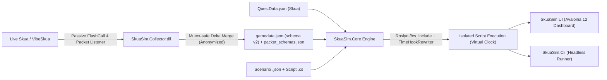

# SkuaSim

**SkuaSim** is an offline, deterministic simulation and testing environment for **Skua** and **VibeSkua** C# scripts.

Instead of running AdventureQuest Worlds (AQW), Flash, or connecting to live game servers, SkuaSim compiles real Skua scripts with Roslyn and executes them against an in-memory simulation of Skua's `IScriptInterface` (`Player`, `Map`, `Monsters`, `Combat`, `Kill`, `Hunt`, `Inventory`, `Bank`, `Drops`, `Quests`, `Shops`, `Reputation`, `Boosts`, `Wait`, `Config`, `Send`, etc.) backed by anonymized game metadata passively captured during normal play.

It is built to reproduce bug reports and validate fixes: the same script, scenario and seed always produce the same result, every API call can be traced, and infinite loops are detected automatically.

> **Disclaimer:** SkuaSim does **not** redistribute AQW game assets, servers, or Skua/VibeSkua binaries. It resolves your local Skua/VibeSkua assemblies at runtime and operates entirely offline.

---

## Architecture & How It Works

SkuaSim is split into two independent halves: a **passive Collector plugin** that runs inside your live Skua/VibeSkua client, and a **standalone offline Simulator** (Core + Desktop UI + CLI) that runs without Flash or an internet connection.



### Key Mechanics

1. **Real Roslyn Compilation (`//cs_include`):** Scripts (including deep dependency trees with 100+ includes such as `CoreBots.cs`, `CoreFarms.cs`, `CoreAdvanced.cs`, and `ArmyFarmerJoeDoAll.cs`) are compiled directly against your installed `Skua.Core.*` assemblies inside a collectible per-run `AssemblyLoadContext`.
2. **Virtual Clock & AST Time Rewriting (`TimeHookRewriter`):** Calls to `Thread.Sleep`, `Task.Delay`, `DateTime.Now/UtcNow`, `Stopwatch`, and `Bot.Sleep`/`Bot.Wait` are intercepted and driven by a deterministic virtual clock (`SimClock`). Multi-hour, multi-day, or multi-week farms run in seconds. Scripts that poll the API in a tight loop without sleeping get the clock nudged forward automatically.
3. **Determinism:** All randomness comes from the run's seed, and IDs derived from names use a process-independent hash (`StableHash`), so the same script + scenario + seed is identical across runs *and* across processes (verified by an automated two-process test).
4. **Three-Tier Data Fidelity:**
   - **Tier 1 — Scenario Overrides:** Explicit starting character, class, gear boosts, unlocked enhancements, active quests, script options, and custom map/monster/drop rules.
   - **Tier 2 — Real Game Data:** Captured AQW data from `SkuaSim.Collector` (`gamedata.json`) plus Skua's `QuestData.json` (10,000+ quests).
   - **Tier 3 — Synthesized Fallback:** When a script visits a map, monster, item, or shop never observed by the collector, SkuaSim infers defaults — assisted by static AST hints from the script's literal `KillMonster`/`HuntMonster`/`KillQuest`/`BuyItem` calls, and by spawning on demand a monster the script explicitly asks to fight on an uncaptured map — and **flags every invented entity in Violet** in the UI and in reports.
5. **Honest Drop Rates:** Captured drops are rolled with their observed rate. Quest-gated items only drop while one of their quests is active. A known drop without a trustworthy measured rate (official list only, or quest-gated but not yet measured with the quest active) uses an invented, Violet-flagged chance — never 0 %, which would make scripts loop forever.
6. **No-Progress (Stalled) Detector:** If the player's level, XP, gold, items, quests, story progress and reputation stay unchanged for `limits.maxNoProgressMinutes` of virtual time (default `60`, `0` disables), the run stops with outcome **Stalled** and names the API calls the script kept repeating — so infinite loops are caught automatically instead of running until someone clicks Stop. The CLI exits with code `3` (`--max-no-progress-min` overrides the scenario).
7. **AQW Stat & Combat Engine (`StatEngine`):** Computes AQW primary/secondary stats (`STR`, `INT`, `END`, `DEX`, `WIS`, `LCK`, `AP`, `SP`, `Crit`, `Crit Multiplier`, `50% Haste cap`, `Dodge/Evasion`), calibrated by captured class skills (`sAct`) and combat telemetry (`ct`), alongside Awe/Forge enhancement procs and AQW's highest-in-category gear boost stacking rules.

---

## Requirements & Dependencies

### Runtime & Build Prerequisites
- **OS:** Windows (10 / 11) — scripts such as `CoreBots.cs` reference `System.Windows.Forms`.
- **.NET SDK:** `.NET 10.0` (`TargetFramework: net10.0`)
- **Skua or VibeSkua Installation:**
  - Automatically detected at runtime via `SkuaInstallation.Detect()` (checks `%LOCALAPPDATA%\VibeSkua\current\Assemblies`, `%APPDATA%\VibeSkua`, and standard Skua directories), overridable with the `SKUASIM_SKUA_ASSEMBLIES` / `SKUASIM_SKUA_DATA` environment variables or the **Skua Dir...** button in the UI.
  - Required assemblies are taken from your local Skua/VibeSkua install at build and run time (never bundled in this repo):
    - `Skua.Core.dll`, `Skua.Core.Interfaces.dll`, `Skua.Core.Models.dll`, `Skua.Core.Utils.dll`
    - `CommunityToolkit.Mvvm.dll`, `Newtonsoft.Json.dll`
    - `Microsoft.CodeAnalysis.dll`, `Microsoft.CodeAnalysis.CSharp.dll`
  - If your Skua/VibeSkua assemblies are in a custom directory when building from source, pass `-p:VibeSkuaDir="C:\path\to\Assemblies"`.

### NuGet Dependencies (`SkuaSim.UI`)
- `Avalonia` `12.1.6`
- `Avalonia.Desktop` `12.1.6`
- `Avalonia.Themes.Fluent` `12.1.6`
- `Avalonia.Fonts.Inter` `12.1.6`
- `CommunityToolkit.Mvvm` `8.4.2`

---

## Implemented Features

### 1. `SkuaSim.Collector` — Passive Data Collector Plugin
Runs silently inside Skua or VibeSkua on a non-blocking background `Channel<Action>` without interfering with gameplay or running scripts. It never sends packets to the server; it only reads what the client already receives.

- **World & Economy Capture:** Maps, cells, pads, monsters (ID, name, race, **level** and **weapon DPS** from `moveToArea.monBranch`, HP, spawn cells), map items (`getMapItem`, granted items and the quests they require), drops (observed counts, quantities and rates), shops (`loadShop`, merge recipes, costs), and quests (`getQuests` requirements and **rewards with type and rate**, `ccqr` turn-ins).
- **Accurate Drop Attribution:** Only the monster killed in the last 5 s is credited with a drop; items arriving right after a quest turn-in that are rewards of that quest are excluded, and items with no recent kill (quests, merges, map items, shops) are never credited to a monster.
- **Quest-Gated Drop Precision:** Items that are only obtainable while a quest is active (the server's `sReqQuests`) are tracked against kills made **with that quest active**, using the client's active quest list (`Bot.Quests.Active`, kept in RAM only).
- **Official Drop Lists, Passively:** When any tool requests a monster's official drop list (e.g. the Weekly/Merge generator scripts), the `monsterDrops` response is captured and merged (official + quest-gated flags, quest names). These lists carry no rates; rates still come from observed kills.
- **Room Capacity (experimental):** After joining a room, the room player cap is read from the game client (`world.areaData.intMaxPlayers`). The source is still being verified; every probe is counted in the packet census.
- **Combat, Class & Boss Telemetry:** Real class skills (`sAct`), stat snapshots (`stu`), player hits/crits/heals/dodges, monster attacks (`ct.sara[].actionResult`), HoT/DoT ticks (`typ: "d"`), auras & stack counts (`stk`), boss animations (`animStr`), event zones (`event`), and weapon/enhancement procs.
- **Multi-Client (Army) & Multi-Session Safe:** Merges incremental deltas atomically across simultaneous clients using a global cross-process `Mutex` and `.tmp → .bak → .json` atomic writes, with optional mirroring to an extra path (by default the `SkuaSim\data\` workspace folder when found).
- **Schema v2 with Safe Migration:** `gamedata.json` is versioned (`SchemaVersion: 2`). An older file is copied to a dated `gamedata.v1-backup-<UTC>.json` and migrated in place on the next save: impossible drop records (more drops than kills) are removed, temporary quest-required drops become quest-gated with an "unverified" rate, and the change is recorded in `MigrationLog`.
- **Protocol Verification Sampler (`packet_schemas.json`):** Accumulates anonymized samples of an allowlist of world packets (combat, boss, events, `moveToArea`, `addGoldExp`, drops, quests, `monsterDrops`, `respawnMon`), value-free key skeletons for unknown commands, and a census of command names and counts — used to confirm real packet keys before writing parsers.
- **Zero Personal Data:** Never records usernames, character names, account IDs, chat messages, IP addresses, personal inventory/bank state or the player's house. Redacts `unm`, `uid`, `casterId`, `CharItemID`, `iQtyNow` and player names from samples; inventory, bank, friend, chat, login and house packets are never sampled.
- **Plugin Options:** Active Collection, Combat Details, Save Interval (s), Mirror File Path, Packet Schema Sampler.

### 2. `SkuaSim.Core` — Offline Simulation Engine
- **Script Compilation & Inspection:** Recursive `//cs_include` resolver, Roslyn compiler with full diagnostic reporting (`file(line,col) [ID]`), and standalone `InspectScript()` discovery for `Options`, `MultiOptions`, `OptionsStorage`, enums, defaults, and header rows.
- **Dynamic API Proxy (`ProxyHub`):** Implements Skua interfaces via `DispatchProxy` with `DynamicMethod` non-virtual default-interface-method invocation and automatic tracking of unimplemented members (`STUB` diagnostics).
- **Simulated World (`SimWorld`):** Maps, cells, monsters with real captured levels/HP/races, respawns, combat, XP → level progression, drops (observed, quest-gated and synthesized), shops, quests, factions, bank and inventory.
- **AQW StatEngine & Equipment Boosts:**
  - Level 1–100 stat scaling, enhancement patterns (Lucky, Wizard, Fighter, Thief, Hybrid, Healer, Spellbreaker, Forge Helms/Capes, Awe & Forge Weapon procs), and live `%xt%zm%enhanceItemShop%` packet support.
  - **Real AQW Boosted Gear Catalog (`AqwBoostGearCatalog`):** Curated per-slot (`Weapon`, `Armor`, `Helm`, `Cape`, `Pet`) real AQW items with multi-boost `Meta` tags (e.g., *Necrotic Sword of Doom*, *Radiant Goddess of War*, *Head of the Legion Beast*, *Awescended Omni Wings*, *Polly Roger*) following AQW's highest-in-category stacking rules.
  - **Awe & Forge Enhancement Unlocks (`EnhancementUnlockCatalog`):** Unlocks the corresponding AQW enhancement quests (`#2937` for Awe; Forge Weapon/Helm/Cape quest IDs from `CoreAdvanced.cs`, plus `Grimskull Trolling` Rank 7 for Hearty) and equips class-appropriate starting enhancements.
  - **Consumable & Server Boosts (`Bot.Boosts`):** `2x` XP, Class Points, Gold, Reputation, and Server boost multipliers.
- **Simulation Limits & Control:**
  - Virtual time limit from minutes to weeks, or **Unlimited (`0`)**, with multi-day clock formatting (`Xd hh:mm:ss.fff`).
  - Wall-clock limit defaults to **Infinite (`0`)** and excludes cold Roslyn compile time; a real-time stall guard stops pure-CPU loops that never call the API.
  - **No-progress detector** (virtual-time based, see Key Mechanics).
  - Live `Pause` / `Resume`, `Stop`, and speed pacing (`Instant (Max)`, `1x (Real-time)`, `5x`, `20x`, `100x`).

### 3. `SkuaSim.UI` — Avalonia 12 Desktop Dashboard ("Skua without Flash")
- **Multi-Resolution & Typography Scaling:** Adaptive scaling (`Auto (Screen)`, `HD (720p)`, `Full-HD (1080p)`, `2K (1440p)`, `4K (2160p)`, `8K (4320p)`) with standardized typography resources and responsive resizable splitters across every pane.
- **Live Client Tab:** Real-time view of Map/Cell/Pad, Target, Monsters (with HP bars and `[SYNTH]` markers), Player Level/HP/Class/Rank/Gold/ACs/Stats, Inventory, Bank, Temp Inventory, Pending Drops, Quests, Factions, and Map Cells.
- **Scenario & Script Options Tab:**
  - **Databank Class Picker & Live Stats Preview:** Pick any class captured in `gamedata.json` (or a built-in archetype) and preview computed HP, DPS, Crit, Haste, Dodge, and boost multipliers.
  - **Boosts & Real AQW Equipment Selector:** Toggle `2x` consumable/server boosts and equip real AQW boosted items per slot (plus **Endgame Meta** and **Clear Gear** presets).
  - **Awe & Forge Checklists:** Individual enhancement checkboxes plus **Select All Awe**, **Select All Forge**, and per-category **All Weapon**, **All Helm**, and **All Cape** toggles.
  - **Limits:** Virtual duration, Max Real (s), Stall (s) and **No Progress (min)**.
  - **Skua-Faithful `Script Options` Panel:** `CheckBox`es for `Option<bool>`, `ComboBox`es for enums, `TextBox`es for strings/numbers, info banners for `Option<string>(" ", ...)` headers, `TabControl` grouping in exact `MultiOptions` order, **Reset Defaults**, and **Load Skua .cfg** to import saved Skua script settings.
  - Quick templates (**Lv 1 Starter**, **Lv 100 Endgame**), **Save / Save As...** JSON persistence, and instant application on **Run**.
- **Color-Coded Diagnostics & Report Export:**
  - **Script Logs**, **Errors & Diagnostics** (including a dedicated **Stalled (No Progress)** banner), and a searchable **API Call & World Trace** timeline with severity badges (`ERR`, `ALERT`, `WARN`, `OK`, `WORLD`, `API`, `STUB`) and **Violet (`SYNTH`)** highlighting for synthesized data.
  - Export full execution reports as **Markdown (`.md`)** or **JSON (`.json`)**.

### 4. `SkuaSim.Cli` — Headless Command-Line Runner
Terminal interface for scripting and automated regression runs: `db-stats`, `compile`, and `run`.

| `run` option | Meaning |
|---|---|
| `--scenario, -s <file.json>` | Scenario describing the player/world state |
| `--seed <int>` | Random seed (default `42`) |
| `--max-virtual-min <min>` | Virtual time limit (scenario default `360`; `0` = unlimited) |
| `--max-real-sec <sec>` | Wall-clock limit (default `0` = unlimited) |
| `--max-no-progress-min <min>` | Stop as Stalled after this long without progress (default `60`; `0` = off) |
| `--report, -o <file.md\|.json>` | Save the execution report |
| `--trace <file.jsonl>` | Stream the full API trace |
| `--gamedata <path>` | Use another `gamedata.json` |

Exit codes: `0` completed/stopped, `2` compile error or script exception, `3` stalled.

---

## Project Structure

```text
SkuaSim/
├── SkuaSim.slnx                    # Solution file (.NET 10)
├── CLAUDE.md                       # Notes and invariants for AI-assisted development
├── PLAN.md / CONTEXT.md            # Roadmap, phase status, design history
├── src/
│   ├── SkuaSim.Collector/          # Passive Skua/VibeSkua plugin (ISkuaPlugin)
│   │   ├── Diagnostics/            # PacketSchemaSampler (packet_schemas.json, command census)
│   │   ├── Models/                 # Captured maps, monsters, drops (DropRates), items, quests, classes
│   │   ├── Parsing/                # PacketCollectorEngine (JSON/XT packet parsers)
│   │   └── Storage/                # GameDatabaseStore (Mutex-safe merge, atomic save), v1→v2 migration
│   ├── SkuaSim.Core/               # Offline compiler, virtual runtime, StatEngine & SimWorld
│   │   ├── Api/                    # Simulated IScriptInterface sub-APIs
│   │   ├── Compilation/            # //cs_include loader, Roslyn compiler, TimeHookRewriter, AST hints
│   │   ├── Data/                   # GameDataCatalog (gamedata.json + QuestData.json)
│   │   ├── Hosting/                # SkuaInstallation detector & SkuaAssemblyResolver
│   │   ├── Proxies/                # DispatchProxy hub for Skua interfaces
│   │   ├── Runtime/                # SimClock, SimContext (watchdogs), SimulationRunner, SimulationSession
│   │   ├── Scenarios/              # Scenario schema, AqwBoostGearCatalog, EnhancementUnlockCatalog
│   │   └── World/                  # SimWorld, StatEngine, StableHash
│   ├── SkuaSim.UI/                 # Avalonia 12 desktop application
│   └── SkuaSim.Cli/                # Headless CLI executable (skuasim)
├── tests/
│   ├── SkuaSim.Collector.Tests/    # Parsing (incl. real anonymized packets), privacy, merge, schema v2 (9 suites)
│   └── SkuaSim.Core.Tests/         # Compilation, determinism (incl. cross-process), stats, boosts, stall detector, drops (14 suites)
├── scenarios/                      # Ready-to-use JSON scenarios (starter, leveling, dailies, VHL farm, Forge unlocks, ...)
├── data/                           # Local gamedata.json mirror, packet_schemas.json & sample reports (git-ignored)
└── dist/plugins/                   # Release SkuaSim.Collector.dll for Skua/VibeSkua (git-ignored)
```

---

## Getting Started

### 1. Build the Solution
```powershell
dotnet build SkuaSim.slnx
```
*(Optional: if your Skua/VibeSkua assemblies live in a custom folder, append `-p:VibeSkuaDir="C:\path\to\Assemblies"`.)*

### 2. Install the Passive Collector Plugin (Optional, Recommended)
Build `SkuaSim.Collector` in Release mode and copy `SkuaSim.Collector.dll` into your client's `plugins/` folder **with the client closed** (the DLL is locked while it runs):
```powershell
dotnet build src\SkuaSim.Collector\SkuaSim.Collector.csproj -c Release
```
Copy `src\SkuaSim.Collector\bin\Release\net10.0\SkuaSim.Collector.dll` to:
- **VibeSkua:** `%APPDATA%\VibeSkua\plugins\` (and/or `%LOCALAPPDATA%\VibeSkua\current\plugins\`)
- **Official Skua:** `%APPDATA%\Skua\plugins\`

Launch Skua/VibeSkua and play or run bots normally. Collected anonymized data is saved to `%APPDATA%\VibeSkua\SkuaSim\gamedata.json` (plus `packet_schemas.json`) and mirrored to `data\gamedata.json` when the workspace is found. Migration backups (`gamedata.v1-backup-*.json`) are written next to the primary file.

### 3. Launch the Desktop UI
```powershell
dotnet run --project src\SkuaSim.UI\SkuaSim.UI.csproj
```
Or launch the compiled binary directly at `src\SkuaSim.UI\bin\Debug\net10.0\SkuaSim.UI.exe`.

### 4. Run from the CLI
```powershell
# Inspect detected Skua install & captured database statistics
dotnet run --project src\SkuaSim.Cli\SkuaSim.Cli.csproj -- db-stats

# Compile a script and verify all //cs_include dependencies
dotnet run --project src\SkuaSim.Cli\SkuaSim.Cli.csproj -- compile "Other/FarmJoeKits/0FarmerJoeDoAll.cs"

# Execute a headless simulation with a scenario, fixed seed, and Markdown + JSONL outputs
dotnet run --project src\SkuaSim.Cli\SkuaSim.Cli.csproj -- run "Other/FarmJoeKits/0FarmerJoeDoAll.cs" `
    --scenario scenarios\farmerjoe_lv1_mage.json `
    --seed 42 `
    --max-virtual-min 360 `
    --report data\last_run_report.md `
    --trace data\last_run_trace.jsonl
```
Script paths are relative to the VibeSkua `Scripts\` folder (`%APPDATA%\VibeSkua\Scripts`) or absolute.

### 5. Run the Automated Test Suites
```powershell
dotnet run --project tests\SkuaSim.Collector.Tests\SkuaSim.Collector.Tests.csproj
dotnet run --project tests\SkuaSim.Core.Tests\SkuaSim.Core.Tests.csproj
```
The tests are console runners that need a local VibeSkua/Skua install; the Core suite takes a few minutes because it compiles real scripts.

---

## Known Limitations

- **Single player per run.** Army scripts, `Bot.Player.Goto`, party buffs and shared monsters arrive with Phase 4.
- **Fidelity follows the data.** Script logic bugs (loops, conditions, inventory/bank/quest accounting, purchase math) reproduce very well; anything not yet captured is synthesized and flagged. Exact server timing, Ultra boss choreography and Flash client quirks need later phases.
- **Not yet captured:** real XP/gold per kill (the simulator still uses a formula and monsters give no gold), per-monster respawn times (fixed 12 s), consumables (potions/elixirs/tonics/scrolls).
- **Legacy drop data:** data collected before schema v2 may still contain some quest rewards counted as drops (they cannot be separated reliably), and permanent quest items keep a diluted all-kills rate until re-measured.
- **Room capacity** is experimental until its client source is confirmed.

---

## Roadmap

See [PLAN.md](PLAN.md) and [CONTEXT.md](CONTEXT.md) for the full design specification.

- [x] **Phase 1 — Collector Plugin (`SkuaSim.Collector`):** Passive packet capture, class/combat/boss telemetry, cross-process Mutex merge, anonymization, and cross-session packet schema sampling.
- [x] **Phase 2 — Core Simulator & Data World (`SkuaSim.Core` + `SkuaSim.Cli`):** Roslyn `//cs_include` compiler, virtual clock AST rewriter, 3-tier fidelity world, AQW `StatEngine`, real boosted gear & Awe/Forge unlocks, CLI runner.
- [x] **Phase 3 — Desktop Dashboard (`SkuaSim.UI`):** Avalonia 12 live client state, multi-resolution scaling, scenario editor, Skua-faithful Script Options, color-coded diagnostics, and report export.
- [x] **Phase 3.4 — Simulator Robustness:** `KillQuest` hints and on-demand monsters, Stalled detector, cross-process determinism.
- [ ] **Phase 3.5 — Collector Corrections & Schema v2:** protocol verification ✅, monster level / drop attribution fixes ✅, schema v2 with quest-gated rates and passive official drops ✅; next: real XP/gold per kill, respawn times, class-stat modeling and quality items.
- [ ] **Phase 4 — Multi-Client (Army) Simulation:** Up to 20 concurrent simulated players sharing rooms, monster HP pools, party sync, Army coordination files, CoreBots CBO options, live class/enhancement swaps and potions.
- [ ] **Phase 5 — Fault Injection & Scenario Assertions:** Simulated lag/disconnects/drop failures, automated pass/fail assertions, and one-click bug-report diagnostic templates.
- [ ] **Phase 6 — Session Replay & Public Release Packaging:** Real session log replay, OMNISCOPE integration and standalone distribution bundles.
