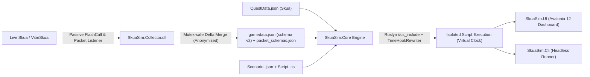

# SkuaSim

**SkuaSim** is an offline, deterministic simulation and testing environment for **Skua** and **VibeSkua** C# scripts.

Instead of running AdventureQuest Worlds (AQW), Flash, or connecting to live game servers, SkuaSim compiles real Skua scripts with Roslyn and executes them against an in-memory simulation of Skua's `IScriptInterface` (`Player`, `Map`, `Monsters`, `Combat`, `Kill`, `Hunt`, `Inventory`, `Bank`, `Drops`, `Quests`, `Shops`, `Reputation`, `Boosts`, `Wait`, `Config`, `Send`, etc.) backed by anonymized game metadata passively captured during normal play.

It is built to reproduce bug reports and validate fixes: the same script, scenario and seed always produce the same result, every API call can be traced, and infinite loops are detected automatically.

> **Disclaimer:** SkuaSim does **not** redistribute AQW game assets, servers, or Skua/VibeSkua binaries. It resolves your local Skua/VibeSkua assemblies at runtime and operates entirely offline.

---

## Architecture & How It Works

SkuaSim is split into two independent halves: a **passive Collector plugin** that runs inside your live Skua/VibeSkua client, and a **standalone offline Simulator** (Core + Desktop UI + CLI) that runs without Flash or an internet connection.



### Key Mechanics

1. **Real Roslyn Compilation (`//cs_include`):** Scripts (including deep dependency trees with 100+ includes such as `CoreBots.cs`, `CoreFarms.cs`, `CoreAdvanced.cs`, and `ArmyFarmerJoeDoAll.cs`) are compiled directly against your installed `Skua.Core.*` assemblies inside a collectible per-run `AssemblyLoadContext`.
2. **Virtual Clock & AST Time Rewriting (`TimeHookRewriter`):** Calls to `Thread.Sleep`, `Task.Delay`, `DateTime.Now/UtcNow`, `Stopwatch`, and `Bot.Sleep`/`Bot.Wait` are intercepted and driven by a deterministic virtual clock (`SimClock`). Multi-hour, multi-day, or multi-week farms run in seconds. Scripts that poll the API in a tight loop without sleeping get the clock nudged forward automatically.
3. **Determinism:** All randomness comes from the run's seed, and IDs derived from names use a process-independent hash (`StableHash`), so the same script + scenario + seed is identical across runs *and* across processes (verified by an automated two-process test).
4. **Three-Tier Data Fidelity:**
   - **Tier 1 — Scenario Overrides:** Explicit starting character, class, gear boosts, unlocked enhancements, active quests, script options, and custom map/monster/drop rules.
   - **Tier 2 — Real Game Data:** Captured AQW data from `SkuaSim.Collector` (`gamedata.json`) plus Skua's `QuestData.json` (10,000+ quests).
   - **Tier 3 — Synthesized Fallback:** When a script visits a map, monster, item, or shop never observed by the collector, SkuaSim infers defaults — assisted by static AST hints from the script's literal `KillMonster`/`HuntMonster`/`KillQuest`/`BuyItem` calls, and by spawning on demand a monster the script explicitly asks to fight on an uncaptured map — and **flags every invented entity in Violet** in the UI and in reports.
5. **Honest Drop Rates:** Captured drops are rolled with their observed rate. Quest-gated items only drop while one of their quests is active. A known drop without a trustworthy measured rate (official list only, or quest-gated but not yet measured with the quest active) uses an invented, Violet-flagged chance — never 0 %, which would make scripts loop forever.
6. **No-Progress (Stalled) Detector:** If the player's level, XP, gold, items, quests, story progress and reputation stay unchanged for `limits.maxNoProgressMinutes` of virtual time (default `60`, `0` disables), the run stops with outcome **Stalled** and names the API calls the script kept repeating — so infinite loops are caught automatically instead of running until someone clicks Stop. The CLI exits with code `3` (`--max-no-progress-min` overrides the scenario).
7. **Real Rewards & Timing:** XP comes from quests and kills, class points from kills, gold from quests, kills and selling items, reputation from quests. Boosts add up — the highest gear bonus of the type (gear of the same type never stacks) + consumable +100 % + server +100 % (1000 rep with a server boost = 2000). Class points per kill follow AQW's rule `230 + 25 × class rank`, reduced when the monster is more than 10 levels below the character (-10 % per level, at least 5 %). Kills give the collector's measured base XP/gold (rule `10 × level` XP and `3 × level` gold when unmeasured, flagged), monsters respawn after their measured delay (~2.4 s in AQW today; the median of measured monsters or AQW's official ~4 s as flagged fallbacks), and reputation comes from the observed quest turn-in rewards, with AQW's rank table (rank 10 = 302,500).
8. **Server Calendar:** A scenario `startDate` sets the virtual date (or `startAtCurrentTime: true` / "Use PC time" in the editor starts at the PC clock). Daily quests reset at 00:00 US Eastern (server time), weekly quests on Friday and monthly quests on the 1st. Optionally, the server-wide double XP/gold/rep/CP boosts listed in the **AE calendar** (`skuasim calendar-update`, from artix.com/calendar — the same source as VibeSkua's Calendar tool) are applied for the virtual date.
9. **AQW Stat & Combat Engine (`StatEngine`):** Computes AQW primary/secondary stats (`STR`, `INT`, `END`, `DEX`, `WIS`, `LCK`, `AP`, `SP`, `Crit`, `Crit Multiplier`, `50% Haste cap`, `Dodge/Evasion`), calibrated by captured class skills (`sAct`) and combat telemetry (`ct`), alongside Awe/Forge enhancement procs and AQW's highest-in-category gear boost stacking rules.
10. **Quest Pets & Unlock Items:** 946 QuestData quests can only be accepted while the character owns an item (`AcceptRequirements`): 317 need a quest pet (188 pets, e.g. the Paragon Pets' Legion Token quests), the rest weapons, classes, armors or house items. As in AQW, the item must be in the **inventory** to accept and to turn in (the bank does not count). Scripts branch on these items (`Core.CheckInventory("Shogun Paragon Pet")`), so the report lists **"Paths That Depend on Items the Character Does Not Own"**, the scenario editor has a **Quest Pets & Unlock Items** panel, and `skuasim whatif <script> --add "<item>"` compares a run with and without the item (e.g. Legion Token farm, 20 virtual minutes: 790 → 1,250 tokens with the Shogun Paragon Pet). A user-run Skua script, `SkuaSim_ExportMyAccount.cs` (kept on the user's Desktop, not in this repository), writes a local scenario of the logged-in character: level, class, member, gold, owned unlock items, quest-slot progress and reputation (no account name).

---

## Requirements & Dependencies

### Runtime & Build Prerequisites
- **OS:** Windows (10 / 11) — scripts such as `CoreBots.cs` reference `System.Windows.Forms`.
- **.NET SDK:** `.NET 10.0` (`TargetFramework: net10.0`)
- **Skua or VibeSkua Installation:**
  - Automatically detected at runtime via `SkuaInstallation.Detect()` (checks `%LOCALAPPDATA%\VibeSkua\current\Assemblies`, `%APPDATA%\VibeSkua`, and standard Skua directories), overridable with the `SKUASIM_SKUA_ASSEMBLIES` / `SKUASIM_SKUA_DATA` environment variables or the **Skua Dir...** button in the UI.
  - Required assemblies are taken from your local Skua/VibeSkua install at build and run time (never bundled in this repo):
    - `Skua.Core.dll`, `Skua.Core.Interfaces.dll`, `Skua.Core.Models.dll`, `Skua.Core.Utils.dll`
    - `CommunityToolkit.Mvvm.dll`, `Newtonsoft.Json.dll`
    - `Microsoft.CodeAnalysis.dll`, `Microsoft.CodeAnalysis.CSharp.dll`
  - If your Skua/VibeSkua assemblies are in a custom directory when building from source, pass `-p:VibeSkuaDir="C:\path\to\Assemblies"`.

### NuGet Dependencies (`SkuaSim.UI`)
- `Avalonia` `12.1.6`
- `Avalonia.Desktop` `12.1.6`
- `Avalonia.Themes.Fluent` `12.1.6`
- `Avalonia.Fonts.Inter` `12.1.6`
- `CommunityToolkit.Mvvm` `8.4.2`

---

## Implemented Features

### 1. `SkuaSim.Collector` — Passive Data Collector Plugin
Runs silently inside Skua or VibeSkua on a non-blocking background `Channel<Action>` without interfering with gameplay or running scripts. It never sends packets to the server; it only reads what the client already receives.

- **World & Economy Capture:** Maps, cells, pads, monsters (ID, name, race, **level** and **weapon DPS** from `moveToArea.monBranch`, HP, spawn cells), map items (`getMapItem`, granted items and the quests they require), drops (observed counts, quantities and rates), shops (`loadShop`, merge recipes, costs), and quests (`getQuests` requirements and **rewards with type and rate**, `ccqr` turn-ins).
- **Accurate Drop Attribution:** Only the monster killed in the last 5 s is credited with a drop; items arriving right after a quest turn-in that are rewards of that quest are excluded, and items with no recent kill (quests, merges, map items, shops) are never credited to a monster.
- **Quest-Gated Drop Precision:** Items that are only obtainable while a quest is active (the server's `sReqQuests`) are tracked against kills made **with that quest active**, using the client's active quest list (`Bot.Quests.Active`, kept in RAM only). Kills are counted per active quest *set*, so a kill made with several of an item's quests active counts once.
- **Real Kill Rewards:** XP, gold and reputation per monster kill from `addGoldExp`, stored as **base values** (the boost/membership bonus is subtracted). Zero rewards from max-level or gold-capped characters are counted apart, never averaged in.
- **Respawn Times:** The delay from a kill to the server's `respawnMon` for the same spawn, per map spawn and per monster (min / max / average).
- **Quest Rewards & Factions:** The base turn-in reward of each quest (`ccqr` `rewardObj`: XP, gold, reputation + faction, class points), which `QuestData.json` does not contain, and the faction ID → name catalog (`addFaction`, `Bot.Reputation.FactionList` — names only, never the player's rank or reputation).
- **Official Drop Lists, Passively:** When any tool requests a monster's official drop list (e.g. the Weekly/Merge generator scripts), the `monsterDrops` response is captured and merged (official + quest-gated flags, quest names). These lists carry no rates; rates still come from observed kills.
- **Room Occupancy:** The peak number of players seen in a room of each map (`Bot.Map.PlayerCount`, a count — never names). The client does not expose the room cap, so this is a lower bound.
- **Combat, Class & Boss Telemetry:** Real class skills (`sAct`), stat snapshots (`stu`), player hits/crits/heals/dodges, monster attacks (`ct.sara[].actionResult`), HoT/DoT ticks (`typ: "d"`), auras & stack counts (`stk`), boss animations (`animStr`), event zones (`event`), and weapon/enhancement procs.
- **Multi-Client (Army) & Multi-Session Safe:** Merges incremental deltas atomically across simultaneous clients using a global cross-process `Mutex` and `.tmp → .bak → .json` atomic writes, with optional mirroring to extra paths (the Mirror File Path option, or one path per line in `mirror_paths.txt` next to the primary file; no mirror by default).
- **Class Stats by Level and Gear:** class combat (hits, crits, dodges, heals) and stat snapshots are kept per 10-level band, class rank and enhancement signature (`L91-100|R10|W9:100|C9:100|H9:100|K9:100`), so an endgame character's gear never inflates a low-level scenario with the same class.
- **PvP:** `PVPE` events (team, type, target; never the player name) and `PVPS` scores per map: event counts, the final score of each match and the ordered event/score sequence.
- **Sharing with Testers:** **Export for Sharing** writes `skuasim_share_<date>.zip` (dates cut to the day, a random per-install contributor ID, the collector builds that produced the data); the maintainer imports it with `skuasim import-data`. Guide for testers: [docs/COLLECTOR_TESTERS.md](docs/COLLECTOR_TESTERS.md).
- **Versioned Schema with Safe Migration:** `gamedata.json` is versioned (`SchemaVersion: 3`). An older file is copied to a dated `gamedata.v<N>-backup-<UTC>.json` and migrated in place on the next save, with each step recorded in `MigrationLog`. v1 → v2 removes impossible drop records (more drops than kills) and marks temporary quest-required drops as quest-gated with an "unverified" rate; v2 → v3 deletes nothing and recomputes quest-gated rates.
- **Protocol Verification Sampler (`packet_schemas.json`):** Accumulates anonymized samples of an allowlist of world packets (combat, boss, events, `moveToArea`, `addGoldExp`, drops, quests, `monsterDrops`, `respawnMon`), value-free key skeletons for unknown commands, and a census of command names and counts — used to confirm real packet keys before writing parsers.
- **Zero Personal Data:** Never records usernames, character names, account IDs, chat messages, IP addresses, personal inventory/bank state or the player's house. Redacts `unm`, `uid`, `casterId`, `CharItemID`, `iQtyNow` and player names from samples; inventory, bank, friend, chat, login and house packets are never sampled.
- **Plugin Options:** Active Collection, Combat Details, Save Interval (s), Mirror File Path, Packet Schema Sampler.

### 2. `SkuaSim.Core` — Offline Simulation Engine
- **Script Compilation & Inspection:** Recursive `//cs_include` resolver, Roslyn compiler with full diagnostic reporting (`file(line,col) [ID]`), and standalone `InspectScript()` discovery for `Options`, `MultiOptions`, `OptionsStorage`, enums, defaults, and header rows.
- **Dynamic API Proxy (`ProxyHub`):** Implements Skua interfaces via `DispatchProxy` with `DynamicMethod` non-virtual default-interface-method invocation and automatic tracking of unimplemented members (`STUB` diagnostics).
- **Simulated World (`SimWorld`):** Maps, cells, monsters with real captured levels/HP/races, measured respawns, combat (measured damage, or a level-calibrated estimate from the monster's `wDPS`), real XP/gold per kill → level progression (gold capped at 100,000,000), reputation gain and ranks, drops (observed, quest-gated and synthesized), quest-gated map items, shops, quests (QuestData, else the collector's captured quest), accept requirements satisfied by inventory, bank **or house** items (e.g. Prime Fiend Shard for the Fiend Shard quests), daily/weekly/monthly resets, bank and inventory.
- **AQW StatEngine & Equipment Boosts:**
  - Level 1–100 stat scaling, enhancement stats from the AQW Wiki tables (`AqwEnhancementTable`: total by level and slot — weapon 200, armor/helm 150, cape 120 at level 100 — split by each pattern's wiki distribution: Adventurer, Fighter, Thief, Hybrid, Wizard, Healer, Spellbreaker, Lucky, Forge, Forge helms with their negative END, Forge capes; Dauntless/Acheron/Elysium weapons), Forge helm/cape passives and Awe & Forge weapon proc buffs as written on the wiki, and live `%xt%zm%enhanceItemShop%` packet support.
  - **Real AQW Boosted Gear Catalog (`AqwBoostGearCatalog`):** Curated per-slot (`Weapon`, `Armor`, `Helm`, `Cape`, `Pet`) real AQW items with multi-boost `Meta` tags (e.g., *Necrotic Sword of Doom*, *Radiant Goddess of War*, *Head of the Legion Beast*, *Awescended Omni Wings*, *Polly Roger*) following AQW's highest-in-category stacking rules.
  - **Awe & Forge Enhancement Unlocks (`EnhancementUnlockCatalog`):** Unlocks the corresponding AQW enhancement quests (`#2937` for Awe; Forge Weapon/Helm/Cape quest IDs from `CoreAdvanced.cs`, plus `Grimskull Trolling` Rank 7 for Hearty) and equips class-appropriate starting enhancements.
  - **Consumable & Server Boosts (`Bot.Boosts`):** `2x` XP, Class Points, Gold, Reputation, and Server boost multipliers, plus the AE calendar's server boosts by virtual date (`boosts.aeCalendarServerBoosts`).
- **Server Warnings & Fault Injection:**
  - Actions the AQW server refuses are refused in the simulator too, and the script receives the server's real message (texts captured by the collector) through `Bot.Events.ExtensionPacketReceived`, so listeners such as CoreBots' `MapIsMemberLocked` run: member-only / unavailable / event-locked joins, purchases without gold, AC or bag space, pickups of items in the bank or at a full stack. Scenario `world.memberOnlyMaps`, `world.unavailableMaps`, `world.eventLockedMaps`; the report lists every message sent.
  - Scenario `faults`: deterministic server faults to test a script's recovery — `buyDesync`, `questDesync`, `slowDown`, `tooSoonAfterCombat`, `disconnect`, `joinFail`, `dropDrought` — triggered by the Nth occurrence of an action (`buy`, `sell`, `turnIn`, `accept`, `join`, `pickup`, `loadShop`, `kill`, `any`), optionally on one `target` and after a virtual minute. Example: [`scenarios/joinlegion_faults_lv100.json`](scenarios/joinlegion_faults_lv100.json).
  - Scenario `asserts`: expected results checked when the run ends, so a bug scenario becomes a regression test. Checks: `outcome`, `item` (`in`: any/inventory/bank/temp/house), `questTurnIns`, `questCompleted`, `level`, `gold`, `coins`, `classRank`, `factionRank`, `kills`, `drops`, `deaths`, `virtualMinutes`, `map`, `mapVisited`, `serverMessage`, `scriptLog`, `warning`, `injectedFaults`, `synthesized`, `synthesizedMaps`, `unimplemented`; numbers use `min` / `max` / `exactly` (`gained: true` compares the change since the start). Without bounds, problem counts (deaths, synthesized, unimplemented) mean "none" and other counts "at least one"; an invalid assert fails, so a typo never passes. Results go to the report ("Scenario Assertions"), the UI status bar and Errors & Diagnostics, and the CLI exit code. Assert behavior, not values that change with the live `gamedata.json` (virtual time, kill counts on maps still being collected). Examples: [`scenarios/sandsea_rep_lv100.json`](scenarios/sandsea_rep_lv100.json), [`scenarios/shaman_rankup_lv100.json`](scenarios/shaman_rankup_lv100.json), [`scenarios/joinlegion_faults_lv100.json`](scenarios/joinlegion_faults_lv100.json):
    ```json
    "script": "Farm/REP/SandseaREP.cs",
    "asserts": [
      { "check": "outcome", "is": ["Completed"] },
      { "check": "factionRank", "name": "Sandsea", "exactly": 10 },
      { "check": "questTurnIns", "exactly": 303 },
      { "check": "deaths" }
    ]
    ```
- **Simulation Limits & Control:**
  - Virtual time limit from minutes to weeks, or **Unlimited (`0`)**, with multi-day clock formatting (`Xd hh:mm:ss.fff`).
  - Wall-clock limit defaults to **Infinite (`0`)** and excludes cold Roslyn compile time; a real-time stall guard stops pure-CPU loops that never call the API.
  - **No-progress detector** (virtual-time based, see Key Mechanics).
  - Live `Pause` / `Resume`, `Stop`, and speed pacing (`Instant (Max)`, `1x (Real-time)`, `5x`, `20x`, `100x`).

### 3. `SkuaSim.UI` — Avalonia 12 Desktop Dashboard ("Skua without Flash")
- **Multi-Resolution & Typography Scaling:** Adaptive scaling (`Auto (Screen)`, `HD (720p)`, `Full-HD (1080p)`, `2K (1440p)`, `4K (2160p)`, `8K (4320p)`) with standardized typography resources and responsive resizable splitters across every pane.
- **Live Client Tab:** Real-time view of Map/Cell/Pad, Target, Monsters (with HP bars and `[SYNTH]` markers), Player Level/HP/Class/Rank/Gold/ACs/Stats, Inventory, Bank, Temp Inventory, Pending Drops, Quests, Factions, and Map Cells.
- **Scenario & Script Options Tab:**
  - **Databank Class Picker & Live Stats Preview:** Pick any class captured in `gamedata.json` (or a built-in archetype) and preview computed HP, DPS, Crit, Haste, Dodge, and boost multipliers.
  - **Boosts & Real AQW Equipment Selector:** Toggle `2x` consumable/server boosts or **AE Calendar Server Boosts**, and equip real AQW boosted items per slot (plus **Endgame Meta** and **Clear Gear** presets).
  - **Virtual Start (UTC):** the run's start date/time (day of week, daily resets, calendar boosts).
  - **Awe & Forge Checklists:** Individual enhancement checkboxes plus **Select All Awe**, **Select All Forge**, and per-category **All Weapon**, **All Helm**, and **All Cape** toggles.
  - **Limits:** Virtual duration, Max Real (s), Stall (s) and **No Progress (min)**.
  - **Skua-Faithful `Script Options` Panel:** `CheckBox`es for `Option<bool>`, `ComboBox`es for enums, `TextBox`es for strings/numbers, info banners for `Option<string>(" ", ...)` headers, `TabControl` grouping in exact `MultiOptions` order, **Reset Defaults**, and **Load Skua .cfg** to import saved Skua script settings.
  - Quick templates (**Lv 1 Starter**, **Lv 100 Endgame**), **Save / Save As...** JSON persistence, and instant application on **Run**.
- **Color-Coded Diagnostics & Report Export:**
  - **Script Logs**, **Errors & Diagnostics** (including a dedicated **Stalled (No Progress)** banner), and a searchable **API Call & World Trace** timeline with severity badges (`ERR`, `ALERT`, `WARN`, `OK`, `WORLD`, `API`, `STUB`) and **Violet (`SYNTH`)** highlighting for synthesized data.
  - Export full execution reports as **Markdown (`.md`)** or **JSON (`.json`)**.

### 4. `SkuaSim.Cli` — Headless Command-Line Runner
Terminal interface for scripting and automated regression runs: `db-stats`, `compile`, `run`, `test` (scenario regression suite), `calendar-update` (downloads the public AE calendar into `data\ae_calendar.json`), `calendar-show [--date <utc>]`, `servers-update` (downloads AQW's public server list into `data\servers.json`, served by `Bot.Servers`; a login that names an unknown or offline server, or a member-only or full one as a non-member, is refused; a scenario `servers` list replaces the file) and `servers-show`. Only the two `*-update` commands use the network.

| `run` option | Meaning |
|---|---|
| `--scenario, -s <file.json>` | Scenario describing the player/world state |
| `--seed <int\|random>` | Seed of the random rolls (drops, quest reward rates, crits, dodges, damage spread); same seed = same run (default `42`; `random` draws a new one, shown in the report — the UI has a **Random** button next to the Seed box) |
| `--max-virtual-min <min>` | Virtual time limit (scenario default `360`; `0` = unlimited) |
| `--max-real-sec <sec>` | Wall-clock limit (default `0` = unlimited) |
| `--max-no-progress-min <min>` | Stop as Stalled after this long without progress (default `60`; `0` = off) |
| `--start-date <utc\|now>` | Virtual start, e.g. `2026-11-20T19:00:00Z`, or `now` for the PC clock (default `2026-01-01T12:00Z`); the report prints the resolved start to reproduce a `now` run |
| `--ae-calendar` | Apply the AE calendar's server boosts for the virtual date |
| `--calendar <path>` | Calendar file (default `ae_calendar.json` next to `gamedata.json`) |
| `--report, -o <file.md\|.json>` | Save the execution report |
| `--trace <file.jsonl>` | Stream the full API trace |
| `--export-scenario <file.json>` | Save the character at the end of the run as a new scenario, to chain scripts |
| `--gamedata <path>` | Use another `gamedata.json` |

`whatif <script.cs> --add "<item>" [--add ...]` runs the script twice with the same seed (as is, and with the items in the inventory) and prints the difference (quests, kills, gold, items gained).

`import-data <share.zip> [...]` stores other testers' shared data in `data\contrib\` (the newest export per contributor; own exports and files without a contributor ID are refused). Every simulation merges those files into `gamedata.json` in memory (`gamedata.json` is never changed); the trace and `db-stats` list them.

`run` takes the script from the scenario's `"script"` field when none is given.

`test [<scenario.json|folder> ...] [--data <snapshot>] [--gamedata <path>] [--report-dir <dir>]` is the regression suite: it runs every scenario (default folder `scenarios\`) that has both `"script"` and `"asserts"`, prints PASS/FAIL per scenario (and which data it read) and skips the others.

`snapshot create [<name>] [--note <text>]` freezes the data a run reads now — `gamedata.json` with the shared data merged and migrated, Skua's `QuestData.json` and the AE calendar — into `data\snapshots\<name>\` (default name: today's UTC date) with a `snapshot.json` manifest (sources, counts, SHA-256 of each file). A scenario with `"dataSnapshot": "<name>"`, or `run`/`test`/`whatif --data <name|folder>`, reads only those files, so its results stay the same while the collector keeps writing; the report shows `Game Data: snapshot …`, a changed snapshot file is warned about, and a missing snapshot fails the run instead of using live data. Snapshots are never overwritten. `snapshot list` shows them and checks their files.

`bug-report <diagnostic.json> [<script.cs>] [--out <file.md>] [--report <full.md>] [--data <snapshot>]` turns a bug report into a reproduction. The reporter runs `toolsskuaSkuaSim_Diagnostic.cs` in Skua on the character that hit the bug; it saves that character as a scenario (level, class/rank/CP, gold/ACs, location, inventory/bank/house/temp items with enhancements, story slots, dailies done, reputation, running boosts, Awe/Forge unlocks, client options and the reported script's saved options; never the character name, guild, password or server, and no option that may hold an account or player name). `bug-report` runs the reported script on it and writes the filled [bug report template](docs/BUG_REPORT_TEMPLATE.md) (`<diagnostic>.bugreport.md`): character, outcome, exception, script log, how much to trust the run (uncollected maps, invented data, unimplemented API members) and asserts to start the regression test from.

`harvest-plan [--out <file.json>] [--max-stops <n>] [--scripts <dir>]` lists what the scripts use that the collected data still lacks — maps never captured, monsters without an official drop list, shops and quests never seen — ordered by how many scripts need them, in `%LOCALAPPDATA%\SkuaSim Harvest\harvest_plan.json` (not Documents: OneDrive sync locks the shared progress file). Run `tools\skua\SkuaSim_Harvester.cs` in Skua (Collector plugin installed) on one or more clients at the same time: they share a progress file, split the stops, and visit each map's cells, request each monster's official drop list (the Weekly/Merge generators' request; 1 s between requests by default), and load the shops and quests. It never fights on purpose, accepts or completes quests, or buys, and it resumes where it stopped. With the option **Sample drop rates (layer B)** each client instead farms one monster alone in a private room (drops are shared per kill, so several clients in one room would count one kill several times) to measure the drop rates of the normal, official drops the scripts farm; monsters too strong for the character are marked and skipped. Maps whose rooms open in order (doomvault) are cleared room by room. Each `harvest-plan` also writes `harvest_blocked.md`: maps the harvester could not join, by the reason the server gave (member-only, event, seasonal, full, or locked by story progress) and the story scripts to run on the army to unlock the locked ones. `HarvestRetryFailed.bat` (`--retry-failed`) tries failed stops again; `HarvestPlanFromScratch.bat` (`--all --reset`) archives the progress and revisits everything, also what is already collected.

Exit codes (`run`): `0` completed/stopped, `2` compile error or script exception, `3` stalled. When the scenario has `asserts`, they decide instead (the expected outcome is one of them): `0` all passed, `4` an assert failed; a compile error stays `2`. `test`: `0` all passed, `4` a scenario failed, `1` nothing to run.

---

## Project Structure

```text
SkuaSim/
├── SkuaSim.slnx                    # Solution file (.NET 10)
├── CLAUDE.md                       # Notes and invariants for AI-assisted development
├── PLAN.md / CONTEXT.md            # Roadmap, phase status, design history
├── src/
│   ├── SkuaSim.Collector/          # Passive Skua/VibeSkua plugin (ISkuaPlugin)
│   │   ├── Diagnostics/            # PacketSchemaSampler (packet_schemas.json, command census)
│   │   ├── Models/                 # Captured maps, monsters, drops (DropRates), items, quests, classes
│   │   ├── Parsing/                # PacketCollectorEngine (JSON/XT packet parsers)
│   │   └── Storage/                # GameDatabaseStore (Mutex-safe merge, atomic save), v1→v2 migration
│   ├── SkuaSim.Core/               # Offline compiler, virtual runtime, StatEngine & SimWorld
│   │   ├── Api/                    # Simulated IScriptInterface sub-APIs
│   │   ├── Compilation/            # //cs_include loader, Roslyn compiler, TimeHookRewriter, AST hints
│   │   ├── Data/                   # GameDataCatalog (gamedata.json + QuestData.json)
│   │   ├── Hosting/                # SkuaInstallation detector & SkuaAssemblyResolver
│   │   ├── Proxies/                # DispatchProxy hub for Skua interfaces
│   │   ├── Runtime/                # SimClock, SimContext (watchdogs), SimulationRunner, SimulationSession
│   │   ├── Scenarios/              # Scenario schema, AqwBoostGearCatalog, EnhancementUnlockCatalog
│   │   └── World/                  # SimWorld, StatEngine, StableHash
│   ├── SkuaSim.UI/                 # Avalonia 12 desktop application
│   └── SkuaSim.Cli/                # Headless CLI executable (skuasim)
├── tests/
│   ├── SkuaSim.Collector.Tests/    # Parsing (incl. real anonymized packets), privacy, merge, schema v2 (9 suites)
│   └── SkuaSim.Core.Tests/         # Compilation, determinism (incl. cross-process), stats, boosts, stall detector, drops (28 suites)
├── tools/skua/                     # Skua scripts to run in Skua/VibeSkua (SkuaSim_Diagnostic.cs: bug-report diagnostic file;
│                                   #   SkuaSim_Harvester.cs: visits the harvest plan's maps/shops/quests for the Collector)
├── docs/                           # BUG_REPORT_TEMPLATE.md, COLLECTOR_TESTERS.md
├── scenarios/                      # Ready-to-use JSON scenarios (starter, leveling, dailies, VHL farm, Forge unlocks, ...)
├── data/                           # Local gamedata.json mirror, packet_schemas.json & sample reports (git-ignored)
└── dist/plugins/                   # Release SkuaSim.Collector.dll for Skua/VibeSkua (git-ignored)
```

---

## Getting Started

### 1. Build the Solution
```powershell
dotnet build SkuaSim.slnx
```
*(Optional: if your Skua/VibeSkua assemblies live in a custom folder, append `-p:VibeSkuaDir="C:\path\to\Assemblies"`.)*

### 2. Install the Passive Collector Plugin (Optional, Recommended)
Build `SkuaSim.Collector` in Release mode and copy `SkuaSim.Collector.dll` into your client's `plugins/` folder **with the client closed** (the DLL is locked while it runs):
```powershell
dotnet build src\SkuaSim.Collector\SkuaSim.Collector.csproj -c Release
```
Copy `src\SkuaSim.Collector\bin\Release\net10.0\SkuaSim.Collector.dll` to:
- **VibeSkua:** `%APPDATA%\VibeSkua\plugins\` (and/or `%LOCALAPPDATA%\VibeSkua\current\plugins\`)
- **Official Skua:** `%APPDATA%\Skua\plugins\`

Launch Skua/VibeSkua and play or run bots normally. Collected anonymized data is saved to `%APPDATA%\VibeSkua\SkuaSim\gamedata.json` (plus `packet_schemas.json`). To keep a copy in this workspace, put the path of `data\gamedata.json` in `%APPDATA%\VibeSkua\SkuaSim\mirror_paths.txt` (one path per line) or in the Mirror File Path option; without it, SkuaSim falls back to the primary file. Migration backups (`gamedata.v1-backup-*.json`) are written next to the primary file.

### 3. Launch the Desktop UI
```powershell
dotnet run --project src\SkuaSim.UI\SkuaSim.UI.csproj
```
Or launch the compiled binary directly at `src\SkuaSim.UI\bin\Debug\net10.0\SkuaSim.UI.exe`.

### 4. Run from the CLI
```powershell
# Inspect detected Skua install & captured database statistics
dotnet run --project src\SkuaSim.Cli\SkuaSim.Cli.csproj -- db-stats

# Compile a script and verify all //cs_include dependencies
dotnet run --project src\SkuaSim.Cli\SkuaSim.Cli.csproj -- compile "Other/FarmJoeKits/0FarmerJoeDoAll.cs"

# Execute a headless simulation with a scenario, fixed seed, and Markdown + JSONL outputs
dotnet run --project src\SkuaSim.Cli\SkuaSim.Cli.csproj -- run "Other/FarmJoeKits/0FarmerJoeDoAll.cs" `
    --scenario scenarios\farmerjoe_lv1_mage.json `
    --seed 42 `
    --max-virtual-min 360 `
    --report data\last_run_report.md `
    --trace data\last_run_trace.jsonl

# Refresh the local AE calendar, then simulate a run during the 2026-11-20 Double Gold boost
dotnet run --project src\SkuaSim.Cli\SkuaSim.Cli.csproj -- calendar-update
dotnet run --project src\SkuaSim.Cli\SkuaSim.Cli.csproj -- run "Farm/GoldFarm.cs" --start-date 2026-11-20T20:00:00Z --ae-calendar
```
Script paths are relative to the VibeSkua `Scripts\` folder (`%APPDATA%\VibeSkua\Scripts`) or absolute.

### 5. Run the Automated Test Suites
```powershell
dotnet run --project tests\SkuaSim.Collector.Tests\SkuaSim.Collector.Tests.csproj
dotnet run --project tests\SkuaSim.Core.Tests\SkuaSim.Core.Tests.csproj
```
The tests are console runners that need a local VibeSkua/Skua install; the Core suite takes a few minutes because it compiles real scripts.

Scenario regression suite (real scripts with `asserts`, pinned to the frozen data snapshot named in each scenario):
```powershell
dotnet run --project src\SkuaSim.Cli -- test scenarios --report-dir data\test_reports
```
The suite scenarios name `"dataSnapshot": "2026-11-24"`; on another machine create a snapshot first (`skuasim snapshot create 2026-11-24`, from that machine's data) or run with `--data <name>`.

---

## Known Limitations

- **Single player per run.** Army scripts, `Bot.Player.Goto`, party buffs and shared monsters arrive with Phase 4.
- **Fidelity follows the data.** Script logic bugs (loops, conditions, inventory/bank/quest accounting, purchase math) reproduce very well; anything not yet captured is synthesized and flagged. Exact server timing, Ultra boss choreography and Flash client quirks need later phases.
- **Still estimated:** the XP/gold of monsters never measured (rule by level), quest reputation for quests never turned in while collecting, and the gold returned when selling (25 % of the shop price, flagged; AC items return nothing yet). AE resource boosts (Legion Token, Void Aura, Blood Gems…) are listed in the calendar but not simulated. Consumables (potions/elixirs/tonics/scrolls) are not captured.
- **House items** are set in the scenario JSON (`"house": [...]`), like inventory and bank; the editor has no item lists yet.
- **Equipment:** with `player.completeEquipment` (default on) empty Weapon/Helm/Cape slots get basic gear enhanced at the starting level (flagged); it is not re-enhanced while a run levels up. A weapon is always equipped.
- **Legacy drop data:** data collected before schema v2 may still contain some quest rewards counted as drops (they cannot be separated reliably), and permanent quest items keep a diluted all-kills rate until re-measured.
- **Room capacity** is not available from the client; only the peak observed occupancy (a lower bound) is recorded.

---

## Roadmap

See [PLAN.md](PLAN.md) and [CONTEXT.md](CONTEXT.md) for the full design specification.

- [x] **Phase 1 — Collector Plugin (`SkuaSim.Collector`):** Passive packet capture, class/combat/boss telemetry, cross-process Mutex merge, anonymization, and cross-session packet schema sampling.
- [x] **Phase 2 — Core Simulator & Data World (`SkuaSim.Core` + `SkuaSim.Cli`):** Roslyn `//cs_include` compiler, virtual clock AST rewriter, 3-tier fidelity world, AQW `StatEngine`, real boosted gear & Awe/Forge unlocks, CLI runner.
- [x] **Phase 3 — Desktop Dashboard (`SkuaSim.UI`):** Avalonia 12 live client state, multi-resolution scaling, scenario editor, Skua-faithful Script Options, color-coded diagnostics, and report export.
- [x] **Phase 3.4 — Simulator Robustness:** `KillQuest` hints and on-demand monsters, Stalled detector, cross-process determinism.
- [ ] **Phase 3.5 — Collector Corrections & Schema v2/v3:** protocol verification ✅, monster level / drop attribution fixes ✅, schema v2 with quest-gated rates and passive official drops ✅, schema v3 with real XP/gold per kill, respawn times and room occupancy ✅; next: simulator consumption of the new data, class-stat modeling and quality items.
- [ ] **Phase 4 — Multi-Client (Army) Simulation:** Up to 20 concurrent simulated players sharing rooms, monster HP pools, party sync, Army coordination files, CoreBots CBO options, live class/enhancement swaps and potions.
- [x] **Phase 5 — Fault Injection & Scenario Assertions:** scenario faults (de-syncs, disconnects, refused joins, drop droughts), scenario `asserts` + `skuasim test`, frozen data snapshots, and the Skua diagnostic generator + `skuasim bug-report` template.
- [ ] **Phase 6 — Session Replay & Public Release Packaging:** Real session log replay, OMNISCOPE integration and standalone distribution bundles.
